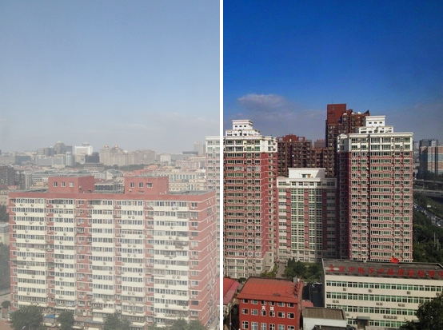
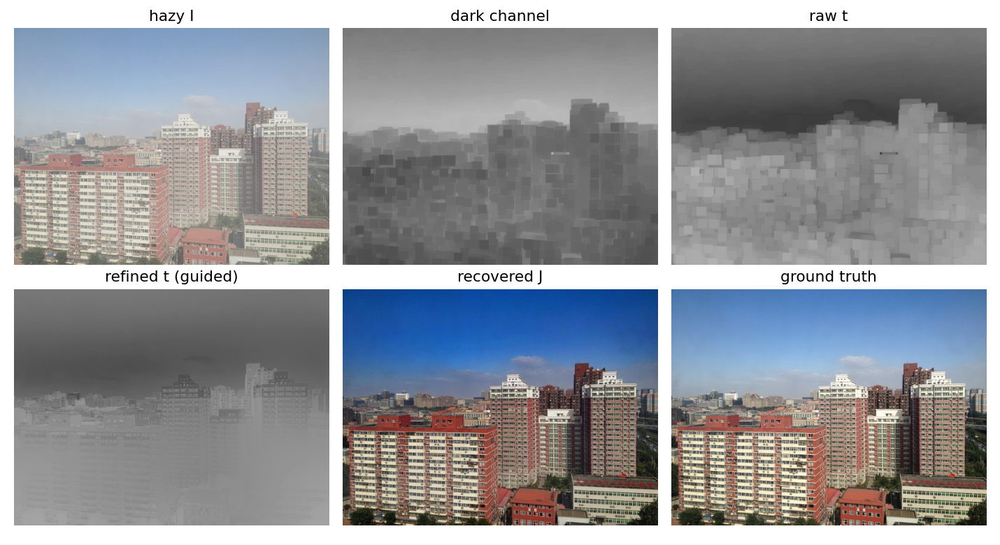

# Single-Image Haze Removal via Dark Channel Prior, with a Temporally Consistent Video Extension

CS7.404 Digital Image Processing project, by Sohail Memon, Kathan Patel and
Md Taufique Hussain. Haze removal implemented from first principles with
classical image processing only: no learned component anywhere in the dehazing
method.



Haze is modelled as `I = J·t + A·(1 − t)`: the camera sees the scene radiance `J`
attenuated by the transmission `t` plus scattered airlight `A`. Recovering `J`
from one image is under-constrained, and the **Dark Channel Prior** (He, Sun and
Tang, CVPR 2009) closes the gap: in haze-free outdoor patches, at least one colour
channel is almost always very dark. The project implements that pipeline, compares
three ways of refining the transmission, and then asks a second question: why does
per-frame dehazing flicker on video, and can classical temporal smoothing fix it?

## What is implemented

**Single image (`dcp/`)**: every stage returns its intermediate output.
- dark channel (patch minimum) and atmospheric-light estimation
- raw transmission, then refinement by **soft matting** (Levin closed-form
  Laplacian, solved with conjugate gradients), a **guided filter** (O(N) box-filter
  form) or a **fast guided filter** (subsampled)
- scene-radiance recovery with a lower bound on `t`
- a classical sky detector and a sky-aware transmission floor

**Video (`dcpvid/`)**: DIS optical flow plus a forward-backward occlusion check, and
four variants:

| Variant | What is smoothed over time |
|---|---|
| V0 | nothing (per-frame DCP baseline) |
| V1 | atmospheric light `A` (exponential moving average) |
| V2 | V1, plus `t` (naive, unwarped) |
| V3 | V1, plus `t` warped by optical flow, with an occlusion mask |

**Evaluation (`eval/`)**: PSNR, SSIM and CIEDE2000 on RESIDE SOTS; per-frame PSNR/SSIM
and temporal metrics (flow-warped flicker index, block-error variance, FPS) on REVIDE.

## Results

Single image, RESIDE SOTS (500 hazy images per split, default settings):

| Split | PSNR (dB) | SSIM | CIEDE2000 |
|---|---|---|---|
| Indoor | 19.82 | 0.859 | 7.43 |
| Outdoor | 17.03 | 0.859 | 10.74 |

- Transmission refinement adds about 1.3 to 1.9 dB over the raw transmission.
- The fast guided filter matches the guided filter within 0.04 dB at about 60% of
  the time. Soft matting scored about 0.1 dB lower than guided and is roughly 100×
  slower (about 35 to 40 s per image; compared on a fixed 25-image subset).
- The paper's defaults (patch 15, ω 0.95) are not PSNR-optimal on SOTS; larger
  patches, smaller ω and a larger `t₀` all score higher. They are reported as a
  sensitivity study, not used to tune on the test set.

Video, REVIDE indoor test split (6 clips, flicker index of the clean video = 1.0):

- Smoothing only the atmospheric light (V1) is the one variant that clearly reduces
  flicker: **2.04 → 1.58** at α = 0.9.
- Smoothing the transmission, naively (V2) or with flow warping (V3), did **not**
  reduce flicker. V3 also fails with ground-truth flow, so it is not a flow-quality
  problem; the cause is not established.
- Freezing `A` is the largest removable cause of flicker. Flicker is about 3× the
  clean video's in the haziest quartile of `t` and about 1.3× in the clearest,
  consistent with noise amplification by `1/t`.

Failure case, sky (200 SOTS-outdoor images): PSNR correlates with sky fraction at
r = −0.50, and a sky-aware transmission floor raises images with at least 25% sky
from 14.47 to 16.87 dB.



## Limitations

- Video results are **indoor only**, on 6 test clips, because REVIDE-outdoor is not
  released. There are no significance tests.
- REVIDE's camera moves, so the proposal's static-region variance was replaced by a
  grid-block error variance.
- The sky mitigation's parameters were chosen once, not tuned, but were scored on
  the same images used to analyse the failure, so the gain is somewhat optimistic.
- Reported timings were measured on a shared CPU; only their ordering is reliable.

## Running it

```bash
cd DIP_HAZE_REMOVAL_DARK_CHANNEL_PRIOR
python3 -m venv --system-site-packages .venv
.venv/bin/pip install -r requirements.txt
.venv/bin/python -m pytest -q tests        # 18 tests
```

```python
import numpy as np, cv2
from dcp import dehaze, load_config

img = cv2.cvtColor(cv2.imread("hazy.png"), cv2.COLOR_BGR2RGB) / 255.0
out = dehaze(img, load_config(**{"refine.method": "guided"}))
# out has: dark, A, t_raw, t_ref, J, depth
```

**Datasets** (not in this repo; they are large):
- RESIDE SOTS → `data/reside/sots/SOTS/{indoor,outdoor}/{hazy,gt}` (HuggingFace
  mirror `desonglll/reside-SOTS`, file `SOTS.zip`)
- REVIDE indoor → `data/revide/indoor/{Train,Test}/{hazy,gt}/<clip>/` (Google Drive
  id `1MYaVMUtcfqXeZpnbsfoJ2JBcpZUUlXGg`, from
  [BookerDeWitt/REVIDE_Dataset](https://github.com/BookerDeWitt/REVIDE_Dataset))

Dataset locations are set in `configs/data.yaml`.

**Regenerate every result and figure** (the long runs are resumable; soft matting
needs several GB of RAM per worker, so the ablation uses 2 workers for it):

```bash
bash scripts/run_all.sh
```

## Layout

```
dcp/                     single-image pipeline and sky mitigation
dcpvid/                  optical flow, occlusion mask, temporal variants V0-V3
eval/                    metrics, benchmark runners, flicker and sky analyses
configs/                 default.yaml (hyper-parameters), data.yaml (dataset paths)
tests/                   synthetic round-trip test and per-stage unit tests
scripts/                 run_all.sh, figure and demo generation
results/                 CSVs behind every reported number
figures/                 plots, transmission maps, side-by-side demo clip
reports/                 Project Report 1 (single image) and Report 2 (video + failure case)
presentation/            final deck (.pptx / .pdf) and its build script
IMPLEMENTATION_LOG.md    every design decision, measurement and deviation, in order
DIP-Project-Proposal.pdf the original proposal
```

Rebuild the reports with `pandoc reports/report1.md -o reports/report1.pdf --pdf-engine=pdflatex`
(same for `report2`), and the deck with `cd presentation && npm install && node make_deck.js`.
[`IMPLEMENTATION_LOG.md`](IMPLEMENTATION_LOG.md) has the full detail, including a solver
bug found while checking reproducibility and how it was fixed.
