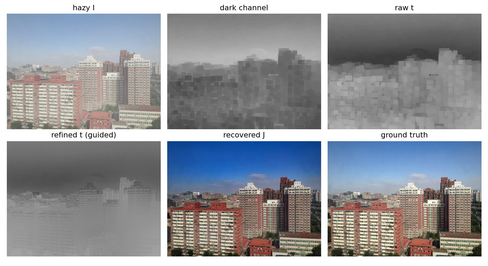

# 1. Problem and approach
Haze mixes scene radiance with scattered airlight according to $I(x)=J(x)t(x)+A(1-t(x))$. Recovering $J$ from one image is under-constrained; He, Sun and Tang's Dark Channel Prior (DCP) supplies the missing constraint: in most local patches of a haze-free outdoor image, at least one colour channel has very low intensity. We implemented DCP from first principles with no learned component, exposing every intermediate output (dark channel, $A$, raw and refined $t$, recovered $J$, relative depth).

# 2. Implementation
| Stage | Method (module in `dcp/`) |
|---|---|
| Dark channel | per-pixel min over RGB, then a square-patch minimum (grayscale erosion), default 15x15 |
| Atmospheric light | top 0.1% of pixels by dark channel; among them the brightest input pixel (alternative: mean of the candidates) |
| Raw transmission | $t=1-\omega\,\mathrm{dark}(I/A)$, $\omega=0.95$ |
| Refinement | (a) soft matting: Levin closed-form Laplacian, solve $(L+\lambda U)t=\lambda\tilde t$ by conjugate gradients; (b) guided filter, O(N) box-filter form; (c) fast guided filter (subsample s=4, upsample the linear coefficients) |
| Recovery | $J=(I-A)/\max(t,t_0)+A$, $t_0=0.1$, clipped to [0,1] |

All hyper-parameters are in `configs/default.yaml` and can be overridden by dotted keys, which is how the ablation is run. Figure 1 shows each stage on a SOTS-outdoor image: the block structure of the raw transmission (from the patch minimum) is removed by refinement, which snaps $t$ to image edges.

{width=95%}

# 3. Correctness test (synthetic round trip)
We generate a haze-free scene that satisfies the prior, a known depth ramp, $t=e^{-\beta d}$ and $A=(0.85,0.88,0.92)$, haze it, run the pipeline and compare against the known truth (`tests/test_synthetic_roundtrip.py`, 4 tests pass). Atmospheric light is recovered to within 0.044 per channel; mean $|t-t_{true}|$ is 0.043 (no refinement) and 0.048 (guided); mean absolute error of $J$ falls from 0.515 (hazy) to about 0.24. The residual error comes mainly from the far region where $t$ is clamped at $t_0$. One honest finding: with brighter scene colours (up to 0.9) the estimator picked a bright object instead of the airlight (0.12 error in blue), which is DCP's known weakness; the scene colours were capped at 0.6 so the test checks the implementation rather than the prior.

# 4. Single-image benchmark (RESIDE SOTS)
Metrics: PSNR, SSIM and CIEDE2000 against ground truth. SOTS-indoor and -outdoor each have 500 hazy images. Default configuration, all 500 images per split:

| Split | PSNR (dB) | SSIM | CIEDE2000 |
|---|---|---|---|
| indoor | 19.82 | 0.859 | 7.43 |
| outdoor | 17.03 | 0.859 | 10.74 |

**Refinement comparison.** Soft matting takes about 35–42 s per image, so the four methods were compared on one fixed 25-image subset per split.

| Method | Indoor PSNR/SSIM | Outdoor PSNR/SSIM | Time per image (s) |
|---|---|---|---|
| none | 18.43 / 0.776 | 16.23 / 0.793 | 0.13–0.20 |
| guided | 20.11 / 0.850 | 17.59 / 0.857 | 0.30–0.35 |
| fast guided | 20.10 / 0.849 | 17.56 / 0.855 | 0.19–0.21 |
| soft matting | 20.01 / 0.849 | 17.48 / 0.853 | 35–42 |

Refinement adds about 1.3–1.9 dB over raw $t$. Fast guided filtering matches guided within 0.04 dB in about 60% of the time. Soft matting was effectively tied with guided on this subset (about 0.1 dB lower) and is roughly 100x slower (its conjugate-gradient solve needs a few thousand iterations per image to converge; an early version that stopped at 2000 iterations gave unstable results, which we fixed); with 25 images the gaps are small and we did not test significance. Timings were taken while other jobs shared the machine, so only the relative ordering is reliable.

**One-factor-at-a-time ablation** (full split, other factors at default):

| Factor | Value | Indoor PSNR | Outdoor PSNR |
|---|---|---|---|
| patch size | 7 / 15 / 31 | 17.52 / 19.82 / 21.37 | 14.98 / 17.03 / 19.18 |
| $\omega$ | 0.80 / 0.90 / 0.95 / 1.00 | 20.49 / 20.73 / 19.82 / 18.06 | 21.26 / 18.78 / 17.03 / 15.13 |
| A estimator | brightest / mean | 19.82 / 19.92 | 17.03 / 17.39 |
| $t_0$ | 0.05 / 0.1 / 0.2 / 0.3 | 19.82 / 19.82 / 19.86 / 20.28 | 17.01 / 17.03 / 17.46 / 18.36 |

The paper defaults ($\omega=0.95$, patch 15) are not the PSNR-optimal values on SOTS: larger patches, smaller $\omega$ and a larger $t_0$ all score higher. A plausible reason is that SOTS haze is synthetic and uniform and PSNR favours conservative dehazing, but we did not verify this, and the result says nothing about visual quality or real haze. We keep the paper defaults as the reported baseline and deliberately do not select a best setting from these test-set numbers.

**Published baselines.** Reported DCP numbers on SOTS vary with protocol: 16.95 dB / 0.792 on indoor ([arXiv 2103.07973](https://arxiv.org/pdf/2103.07973)) versus 20.15 / 0.872 indoor and 17.56 / 0.822 outdoor ([arXiv 1812.07051](https://arxiv.org/pdf/1812.07051)). Our 19.82 / 0.859 (indoor) and 17.03 / 0.859 (outdoor) fall within this spread; we did not verify those papers' evaluation protocols.

# 5. Status and next steps
Objectives 1–3 are complete. Report 2 covers the video extension (Objectives 4–5) and the failure-case analysis (Objective 6). Full detail and every deviation is in `IMPLEMENTATION_LOG.md`; all numbers regenerate with `scripts/run_all.sh`.

# References
1. K. He, J. Sun, X. Tang. Single image haze removal using dark channel prior. CVPR 2009 (TPAMI 2011).
2. K. He, J. Sun, X. Tang. Guided image filtering. ECCV 2010.
3. A. Levin, D. Lischinski, Y. Weiss. A closed-form solution to natural image matting. TPAMI 2008.
4. B. Li et al. Benchmarking single-image dehazing and beyond (RESIDE). IEEE TIP 2019. arXiv:1712.04143.
5. Progressive residual learning for single image dehazing (source of the 16.95 dB / 0.792 DCP figure). arXiv:2103.07973.
6. Unsupervised single image dehazing using dark channel prior loss (source of the 20.15 / 0.872 and 17.56 / 0.822 DCP figures). arXiv:1812.07051.
