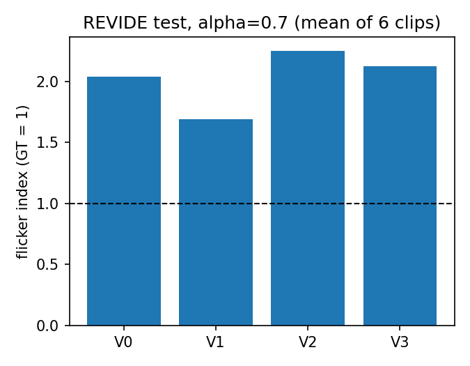
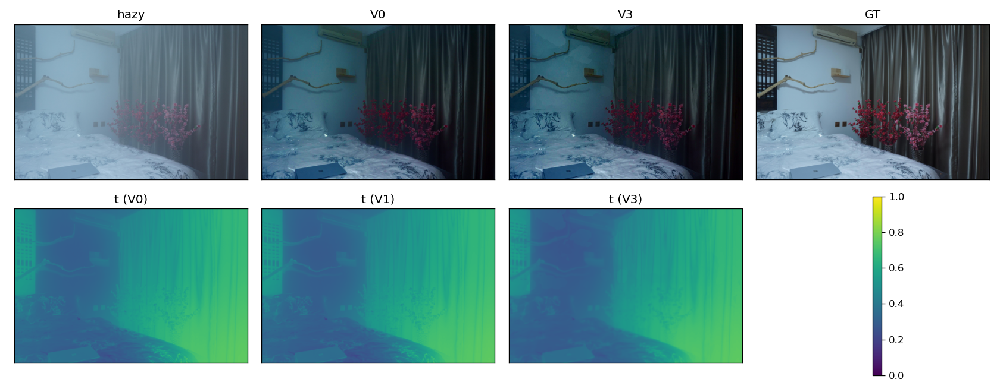
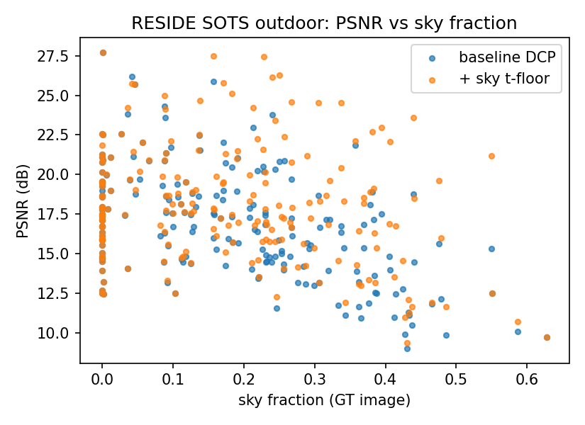

# 1. Problem
Applying DCP independently to each video frame makes atmospheric light $A$ and transmission $t$ jitter even for a static scene, because both come from extremal statistics (a single argmax pixel; a local minimum). We study how much of that flicker can be removed by classical temporal regularization, and which cause dominates.

# 2. Variants
Weights use $s_t=\alpha s_{t-1}+(1-\alpha)x_t$.

* **V0** per-frame DCP.
* **V1** EMA on $A$ only; $t$ is re-estimated under the smoothed $A$ so the two stay consistent.
* **V2** V1 plus an unwarped EMA on $t$.
* **V3** V1 plus an EMA on $t$ whose history is warped to the current frame with OpenCV DIS optical flow, blended only where a forward-backward consistency check passes; occluded or inconsistent pixels use the raw per-frame $t$.

# 3. Setup and metrics
Data: REVIDE **indoor** test split (6 clips, 36–58 frames each, paired hazy/clean), downscaled to width 640. REVIDE-outdoor is not released, so all video results are indoor-only. Frame fidelity: PSNR and SSIM. Temporal metrics:

* **Flicker index**: mean $|J_t-\mathrm{warp}(J_{t-1})|$ over non-occluded pixels, warped with flow computed on the clean ground-truth clip, divided by the same quantity for the ground truth clip (1.0 = natural temporal change; larger = spurious flicker).
* **ROI variance (a deviation from our proposal).** REVIDE's camera moves 5–28 px per frame, so no static region exists. We use a 4x4 block grid and report the temporal variance of each block's mean colour error against ground truth, averaged over blocks.
* FPS on CPU including flow, at width 640.

# 4. Results (mean over the 6 test clips)
| Variant | $\alpha$ | PSNR | SSIM | Flicker idx | ROI var | FPS |
|---|---|---|---|---|---|---|
| V0 | – | 12.72 | 0.678 | 2.04 | 0.0057 | 10.9 |
| V1 | 0.5 | 12.69 | 0.678 | 1.77 | 0.0055 | 9.9 |
| V1 | 0.7 | 12.63 | 0.677 | 1.69 | 0.0054 | 10.0 |
| V1 | 0.9 | 12.44 | 0.672 | **1.58** | 0.0051 | 9.8 |
| V2 | 0.5 / 0.7 / 0.9 | 12.66 / 12.55 / 12.07 | 0.673 / 0.658 / 0.607 | 2.21 / 2.25 / 2.19 | 0.0055 / 0.0055 / 0.0060 | 8.9 |
| V3 | 0.5 / 0.7 / 0.9 | 12.63 / 12.53 / 12.21 | 0.673 / 0.666 / 0.644 | 2.07 / 2.12 / 2.17 | 0.0057 / 0.0057 / 0.0055 | 5.5 |

{width=55%}

**Smoothing the atmospheric light alone (V1) is the only variant that clearly reduces flicker** (2.04 to 1.58 at $\alpha=0.9$), at a small PSNR cost. Smoothing $t$, naively (V2) or with flow warping and an occlusion mask (V3), did **not** reduce flicker in our setup, and V3 costs about twice the time. This contradicts the expectation in our proposal. Absolute PSNR is low (about 12.7 dB) because plain DCP copes poorly with REVIDE's dense indoor haze; differences between variants are small relative to that, and with six clips we did not test significance. Figure 2 shows the V0/V1/V3 outputs and transmission maps for one clip (the side-by-side video is `figures/demo_J004.mp4`).

{width=95%}

## Why V3 does not help
* It is not flow quality: V3 with **ground-truth** flow is also worse than V1 (clip C005: 2.58 vs 2.20; J004: 2.22 vs 1.48 at $\alpha=0.7$).
* V3 does stabilize $t$ itself (flow-warped $t$ difference 0.0063 to 0.0042 on C005), but $J$ flicker does not fall.
* We tested and rejected one explanation (exposure jitter in the hazy input: hazy frames flicker 0.66–0.94 of ground truth). We have **no verified mechanism**. An untested idea is that smoothing $t$ removes the self-compensation DCP's own $t$ has with the per-frame input, so the $1/t$ gain is no longer cancelled.

# 5. Diagnosis of flicker sources (mean over 6 clips)
| Intervention on V0 | Flicker idx |
|---|---|
| baseline | 2.04 |
| $A$ frozen to the clip median | **1.58** |
| $A$ frozen + V3 smoothing of $t$ ($\alpha=0.7$) | 1.94 |
| $t_0=0.3$ | 1.99 |
| $t_0=0.05$ | 2.04 |

Atmospheric-light jitter is the largest removable cause, though strongly clip-dependent (little effect on C005 and E005, large on J004, W002 and L006). Raising $t_0$ barely helps, so boundary clipping is a minor contributor, and smoothing $t$ on top of a frozen $A$ adds flicker. Splitting V0's raw flicker by quartile of $t$ (lowest to highest $t$) gives 0.0289, 0.0208, 0.0150 and 0.0124 against 0.0094 for the ground truth: flicker in the haziest quartile is about 3x the natural change but about 1.3x in the clearest. This is consistent with noise amplification by $1/t$, a fourth cause not in our original list; it would explain why temporal smoothing of $A$ and $t$ cannot reach the ground-truth floor, though we did not isolate it with a direct intervention.

# 6. Failure case: sky and other bright, colourless regions
DCP assumes some channel is dark in every patch; sky violates this, so $t$ is underestimated and the region is over-amplified (see the saturated sky in Report 1, Figure 1). On 200 fixed SOTS-outdoor images we compute the sky fraction from the clean image (classical detector: bright, low-saturation pixels connected to the top row). PSNR correlates with sky fraction at $r=-0.50$.

**Mitigation:** on the hazy image, find the region within 0.10 of $A$ in all channels, low saturation, connected to the top row; feather its mask and raise $t$ to 0.6 inside it.

| Sky fraction | n | Baseline PSNR | Mitigated PSNR |
|---|---|---|---|
| all | 200 | 16.85 | 18.04 |
| < 5% | 54 | 18.26 | 18.35 |
| 5–25% | 82 | 17.78 | 18.76 |
| $\ge$ 25% | 64 | 14.47 | **16.87** |

{width=60%}

The floor value and thresholds were chosen once rather than tuned, but they were evaluated on the same images used for the analysis, so the gain is somewhat optimistic; a held-out check was not done.

# 7. Conclusions
(1) Single-image DCP with guided refinement reproduces expected behaviour on SOTS, refinement adds 1.3–1.9 dB over raw $t$, fast guided matches guided, and soft matting was not worth its roughly 100x cost on the subset we tested. (2) For video, stabilizing the atmospheric light is the effective, cheap fix; the proposed flow-warped transmission smoothing did not help here, and we report that as a negative result with the checks above. (3) Sky is a quantifiable failure mode that a simple, non-learned floor partly repairs. Limits: indoor-only video data, six test clips, no significance testing, CPU-only timings under load. All numbers regenerate with `scripts/run_all.sh`; details and deviations are in `IMPLEMENTATION_LOG.md`.

# References
1. K. He, J. Sun, X. Tang. Single image haze removal using dark channel prior. CVPR 2009 (TPAMI 2011).
2. X. Zhang et al. Learning to restore hazy video: a new real-world dataset and a new method (REVIDE). CVPR 2021. Dataset: github.com/BookerDeWitt/REVIDE_Dataset.
3. T. Kroeger et al. Fast optical flow using dense inverse search (DIS). ECCV 2016.
4. N. Sundaram, T. Brox, K. Keutzer. Dense point trajectories by GPU-accelerated large displacement optical flow (forward-backward consistency check). ECCV 2010.
5. B. Li et al. Benchmarking single-image dehazing and beyond (RESIDE). IEEE TIP 2019.
