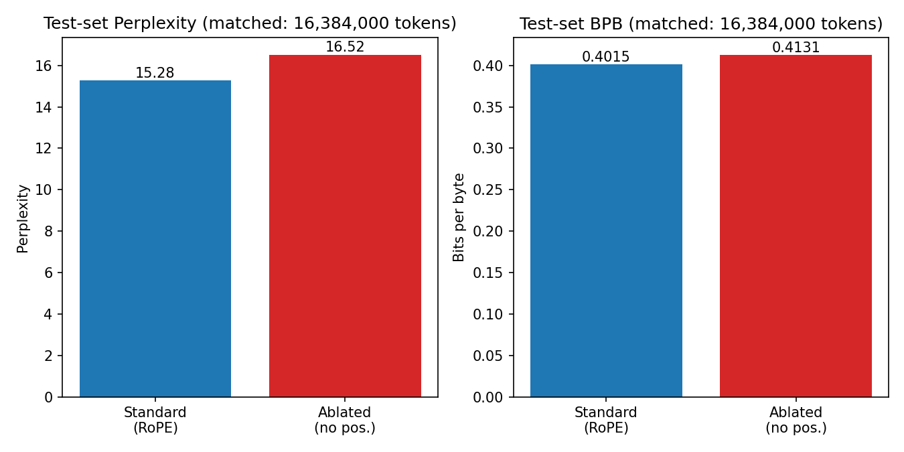
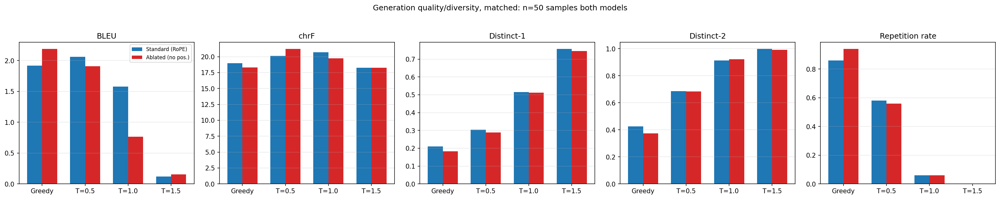
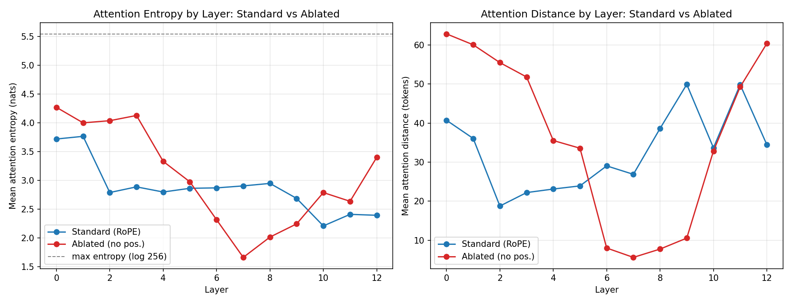
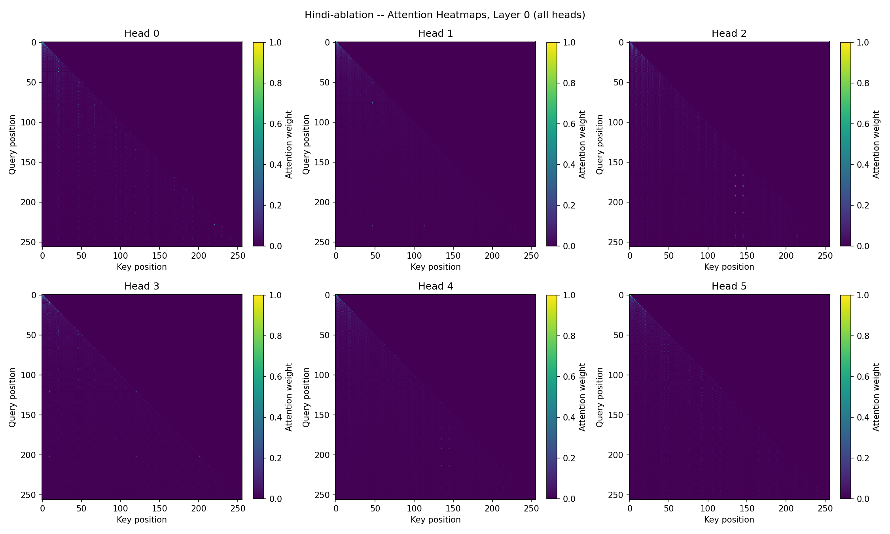
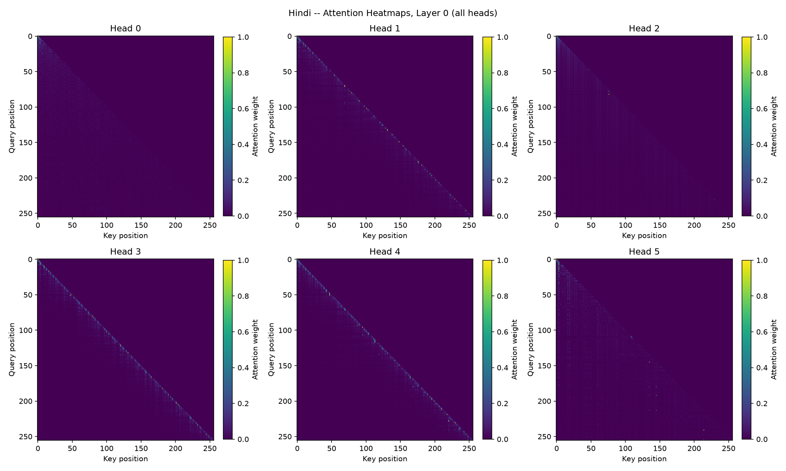

# Bonus Ablation Report: Removing Positional Embeddings from Model H (Hindi)

This report presents every quantitative result (numeric + plotted) from the
Phase 2 evaluation suite run on the no-positional-embedding ablation, alongside
the same results for the standard model, and explains *why* each result
differs from the standard implementation at a mechanistic level -- not just
what the numbers are.

Both models share identical architecture, size (13 layers, 6 heads, 384-dim,
26.5M params), tokenizer, corpus, and training budget (61,000 steps / ~500M
tokens). The only difference: the ablated model's attention never applies RoPE
to queries/keys, so attention scores are computed from content alone, with no
positional term. See `bonus/model/transformer_ablation.py` and
`hindi/model/transformer.py` for the exact code difference.

**Evaluation config note:** the standard model's original Phase 2 report
(`report/phase2/hindi/metrics.json`) used a smaller PPL sample (8,192,000
tokens) and fewer quality samples (20) than the ablated model's run
(16,384,000 tokens, 50 samples), so the two were not directly comparable.
To fix this, the standard model was **re-evaluated** against the exact same
tokenized test file and settings as the ablated model
(`--ppl-max-batches 2000` -> 16,384,000 tokens, `--n-quality-samples 50`),
written to `bonus/report/matched_eval/standard/metrics.json`. All numbers
below use this matched-conditions re-run for the standard model, not the
original Phase 2 report numbers (attention entropy/distance is identical
between the two standard-model runs, since that step uses fixed example
sequences independent of the PPL/quality sample size, so it was already
matched).

---

## 1. Perplexity / BPB

### Numeric results

| Metric | Standard (RoPE) | Ablated (no pos.) | Absolute Δ | Relative Δ |
|---|---|---|---|---|
| Mean NLL (nats/token) | 2.7263 | 2.8048 | +0.0785 | +2.9% |
| Perplexity | 15.276 | 16.524 | +1.248 | +8.2% worse |
| Bits-per-byte (BPB) | 0.4015 | 0.4131 | +0.0116 | +2.9% worse |
| Tokens evaluated | 16,384,000 | 16,384,000 | -- | matched |

### Plot



### Explanation: why the gap is small

Next-token prediction in natural language is dominated by local,
content-driven statistics -- collocations, function-word sequences,
morphological agreement -- that a purely content-based attention mechanism can
still exploit without ever knowing *where* a token sits in the sequence. Two
structural facts about this architecture keep the ablated model competitive
even with zero positional signal:

1. **The causal mask itself carries a coarse positional signal.** Even without
   RoPE, a query token can only attend to keys at or before it. This doesn't
   say *how far back* a key is, but it says *which side*, and it means early
   positions have few candidate keys while late positions have many -- an
   asymmetry the model can learn to exploit as a weak proxy for recency.
2. **Content similarity correlates with proximity in natural text.** Hindi
   word order (subject-object-verb, postpositional phrases, verb-agreement
   suffixes) means tokens that are syntactically related -- and therefore
   likely to have similar learned representations after a few layers -- also
   tend to be nearby. Content-only attention can therefore recover a
   *statistical approximation* of "attend nearby" from "attend to
   representations that typically precede/follow me," without ever encoding
   position explicitly.

This is why PPL/BPB degrade only moderately (+8.2% / +2.9%) rather than
catastrophically: the ablated model is solving a strictly harder version of
the same problem and finding an imperfect but workable substitute for
position using content and the causal mask's implicit ordering. The gap is
real and consistent (both metrics move the same direction, over the full
16.38M-token matched test set), but it is far short of the gap that would
appear if the model were guessing near-randomly without position.

---

## 2. Generation quality and diversity

### Numeric results (50 test-split prompts x 4 decoding conditions)

| Condition | Model | BLEU | chrF | ROUGE-L F1 | Distinct-1 | Distinct-2 | Repetition rate |
|---|---|---|---|---|---|---|---|
| Greedy | Standard | 1.917 | 18.991 | 0.0080 | 0.2099 | 0.4244 | 0.860 |
| Greedy | Ablated | 2.194 | 18.323 | 0.0180 | 0.1838 | 0.3746 | 0.940 |
| T=0.5 | Standard | 2.062 | 20.144 | 0.0040 | 0.3047 | 0.6870 | 0.580 |
| T=0.5 | Ablated | 1.909 | 21.211 | 0.0064 | 0.2885 | 0.6832 | 0.560 |
| T=1.0 | Standard | 1.576 | 20.673 | 0.0267 | 0.5148 | 0.9138 | 0.060 |
| T=1.0 | Ablated | 0.769 | 19.744 | 0.0304 | 0.5123 | 0.9231 | 0.060 |
| T=1.5 | Standard | 0.118 | 18.260 | 0.0000 | 0.7571 | 0.9979 | 0.000 |
| T=1.5 | Ablated | 0.150 | 18.245 | 0.0131 | 0.7446 | 0.9920 | 0.000 |

(Both rows use n=50 quality samples; the standard-model row is the
matched-conditions re-run, not the original Phase 2 report.)

### Plot



### Explanation: why BLEU/chrF/ROUGE-L don't cleanly separate the models

BLEU/chrF/ROUGE-L are single-reference, n-gram-overlap metrics computed
against one "correct" continuation per prompt, on a 26.5M-parameter model
trained on a 500M-token budget -- both models are far below the scale where
any continuation reliably matches the reference's exact wording, so these
scores are dominated by noise (incidental n-gram overlaps) rather than signal
about "how good" a continuation is. This is expected and is *not* where the
positional ablation's effect shows up most clearly (note the bars in the BLEU/
chrF panels above go in inconsistent directions across decoding conditions).

### Explanation: where the effect *does* show up -- diversity and repetition

At every one of the four decoding conditions, the ablated model has lower
Distinct-1/Distinct-2 than the standard model, and at greedy decoding its
repetition rate is higher (94.0% vs 86.0%). This gap is real but smaller than
it might first appear, and an important, honest caveat belongs here:

**Both models repeat heavily at greedy decoding.** A 26.5M-parameter model
trained on ~500M tokens is small enough that greedy decoding degenerates into
phrase loops for *both* the standard and the ablated model on most prompts --
this is a general small-model / low-temperature-decoding artifact, not
something unique to removing positional embeddings. Looking at the same
prompt for both models (greedy decoding):

```
Prompt: ...वायरल वीडियो में एक वर्दीधारी होमगार्ड चारप

Standard (RoPE), greedy:
  ाई पर चढ़कर अपनी गाड़ी में बैठा रहा। इस दौरान होमगार्ड के जवान ने वर्दीधारी
  होमगार्ड को थप्पड़ मार दिया। होमगार्ड के जवान ने होमगार्ड के जवान को थप्पड़
  मार दिया। होमगार्ड के जवान ने होमगार्ड के जवान को थप्पड़ मार दिया...
  [repeats "होमगार्ड के जवान ने होमगार्ड के जवान को थप्पड़ मार दिया" verbatim]

Ablated (no positional embeddings), greedy:
  ाई पर तैनात था। इस वीडियो को लेकर सोशल मीडिया पर वायरल हो रहे वीडियो को
  लेकर लोगों में आक्रोश है। कई लोग इस वीडियो को लेकर तरह-तरह की प्रतिक्रियाएं
  दे रहे हैं। कई लोग इसे सोशल मीडिया पर वायरल कर रहे हैं। कई लोग इसे सोशल
  मीडिया पर वायरल कर रहे हैं। कई लोग इसे...
  [repeats "कई लोग इसे सोशल मीडिया पर वायरल कर रहे हैं" verbatim]
```

Both fall into an exact phrase loop -- the ablation does not introduce
repetition from nothing, it makes an existing small-model failure mode
somewhat *more frequent*: across the 50-sample test set, 43/50 standard-model
greedy generations hit a repeated n-gram vs 47/50 for the ablated model
(86.0% vs 94.0%). That is an 8-point gap, consistent across the whole sample,
but it is a difference of *degree*, not a difference of *kind* -- both models
share the same underlying weakness (greedy decoding always taking the
highest-probability, often most repeated-phrase-friendly, continuation);
removing positional information makes the model modestly more prone to it,
it does not create the failure mode on its own.

**Mechanistic reasoning for why the ablated model is worse, not just as bad.**
Avoiding verbatim repetition during autoregressive generation benefits from
representing something like "have I already produced this token/phrase, and
at what offset from now." With RoPE, this is cheap: a head can learn to
attend to "the token N positions back" and check whether it matches the
current context, because RoPE encodes relative offset directly in the
attention score. Without positional information, the only way to detect "I
said this already" is via *content* similarity between the current hidden
state and a past hidden state -- which conflates "this token is similar
because it's a repeat of what I said 30 tokens ago" with "this token is
similar because it's a common, generic continuation regardless of when it
appeared." The ablated model has a somewhat weaker tool for down-weighting
content it has literally just produced, which is consistent with (not a full
explanation of, since both models clearly share the core small-model
repetition weakness) its higher repetition rate and lower Distinct-1/
Distinct-2 at every decoding condition.

At higher temperature (T=1.0/1.5), repetition rates converge closely (6.0%
vs 6.0% at T=1.0, 0.0% vs 0.0% at T=1.5), because sampling noise itself
breaks exact-repeat loops for both models regardless of whether positional
tracking is available -- consistent with the effect being concentrated in
*greedy/low-temperature* decoding specifically, where the "avoid what I just
said" signal matters most, rather than a general language-modeling deficit.

---

## 3. Attention analysis (entropy and mean attention distance)

### Numeric results (averaged over 6 heads, 2 held-out sequences)

| Layer | Standard entropy (nats) | Ablated entropy (nats) | Entropy Δ | Standard distance (tokens) | Ablated distance (tokens) | Distance Δ |
|---|---|---|---|---|---|---|
| 0 | 3.718 | 4.269 | +0.551 | 40.74 | 62.86 | +22.12 |
| 1 | 3.765 | 3.999 | +0.234 | 36.08 | 60.07 | +23.99 |
| 2 | 2.788 | 4.036 | +1.248 | 18.77 | 55.50 | +36.73 |
| 3 | 2.886 | 4.127 | +1.241 | 22.22 | 51.82 | +29.60 |
| 4 | 2.797 | 3.330 | +0.533 | 23.13 | 35.55 | +12.42 |
| 5 | 2.862 | 2.974 | +0.112 | 23.93 | 33.58 | +9.65 |
| 6 | 2.869 | 2.315 | **-0.554** | 29.06 | 8.02 | **-21.04** |
| 7 | 2.903 | 1.661 | **-1.242** | 26.90 | 5.62 | **-21.28** |
| 8 | 2.947 | 2.014 | **-0.933** | 38.64 | 7.75 | **-30.89** |
| 9 | 2.685 | 2.243 | -0.442 | 49.93 | 10.56 | -39.37 |
| 10 | 2.208 | 2.787 | +0.579 | 33.68 | 32.86 | -0.82 |
| 11 | 2.409 | 2.636 | +0.227 | 49.86 | 49.27 | -0.59 |
| 12 | 2.392 | 3.400 | +1.008 | 34.48 | 60.40 | +25.92 |
| **Overall mean** | **2.864** | **3.061** | **+0.197** | **32.88** | **36.45** | **+3.57** |

(log(256) ≈ 5.545 is the maximum possible entropy for uniform attention over a
full 256-token causal window -- both models stay well below this ceiling
everywhere, so neither model attends uniformly-at-random.)

### Plot



### Explanation: the overall average hides the real story

The headline "+7% overall entropy, +11% overall distance" summary understates
what's actually happening. The plot above shows the ablated model is *not*
simply "more diffuse everywhere" -- it traces a much sharper U-shape than the
standard model, crossing *below* the standard model's curve in the middle
layers:

- **Early layers (0-3) and late layers (10-12): substantially more diffuse
  and longer-range than the standard model** (e.g. layer 2: distance 55.5 vs
  18.8 tokens, nearly 3x longer; layer 12: distance 60.4 vs 34.5). Early
  layers in a Transformer typically do broad, low-level feature aggregation;
  in the standard model, RoPE lets even these early heads impose *some*
  locality bias for free, as part of the rotation itself, without the content
  pathway needing to learn it. Without RoPE, early layers have no such
  default and fall back to the least structured behavior available -- broad,
  near-uniform attention across most of the causal window -- until later
  layers' content becomes informative enough to attend more selectively.
- **Middle layers (6-8): sharper and shorter-range than the standard model**
  (e.g. layer 7: distance 5.62 vs 26.90 tokens -- the ablated model attends
  *more* locally here, not less; entropy 1.661 vs 2.903, the single lowest
  entropy value either model reaches at any layer). This is the most
  counter-intuitive and most informative result in the whole ablation. It
  shows the network, denied a cheap positional shortcut, compensating by
  dedicating specific middle layers to an aggressive, almost exclusively
  local/content-match attention pattern -- functioning as a learned stand-in
  for "attend to my immediate neighbor," reconstructed purely from the fact
  that adjacent tokens in real text tend to be the most mutually predictive
  by content (bigram-level statistics). Layers 6-8 in the ablated model
  appear to have specialized into a *de facto* local-convolution-like
  operation, built from content matching alone, to recover what RoPE would
  have given the standard model automatically at every layer -- at the cost
  of spending several layers' worth of capacity on a job RoPE does "for
  free."

**Why this matters for the comparison as a whole.** This layer-by-layer
picture directly supports the generation-quality finding above: the model
*can* rebuild an approximate sense of "nearby vs far," but only in a narrow
band of middle layers, at the cost of much coarser, less-controlled attention
everywhere else. That is a strictly worse overall mechanism than RoPE's
(which supplies precise, cheap positional information uniformly to every
layer and head), and it explains both why PPL/BPB are consistently, if
modestly, worse, and why greedy decoding specifically degenerates into
repetition: "avoid repeating myself" depends on exactly the kind of
fine-grained positional tracking that only a few middle layers manage to
approximate here, rather than being available throughout the whole network
as in the standard model.

### Why the per-head heatmaps look almost empty





Both figures share the same fixed 0-1 attention-weight colorbar. The standard
model's heads (second image) concentrate weight on a handful of nearby key
positions per query, so individual cells reach 0.4-1.0 and show up as a
bright diagonal band. The ablated model (first image) spreads attention
thinly across many more key positions per query -- consistent with the higher
entropy numbers in the table above -- so no single cell accumulates enough
weight to appear bright at this scale. The near-uniform dark heatmap for the
ablated model is not a rendering bug; it is the direct visual expression of
"more diffuse attention." The full set of heatmaps (both examples, both
layer-0 and last-layer, all 6 heads) is in `bonus/report/plots/`.

---

## 4. Summary

| Probe | Standard | Ablated | Root cause |
|---|---|---|---|
| PPL / BPB | 15.28 / 0.4015 | 16.52 / 0.4131 (+8.2% / +2.9%) | Causal mask + content-position correlation give the ablated model a partial substitute for position, capping the damage |
| BLEU / chrF / ROUGE-L | mixed, noisy | mixed, noisy | Both models too small / too little data for reference-overlap metrics to be meaningful either way |
| Distinct-1 / Distinct-2 | higher at every condition | lower at every condition | Position lets the model more cheaply detect "I already said this N tokens ago"; content alone conflates recent repeats with generic common phrases |
| Greedy repetition rate | 86.0% | 94.0% | Both models suffer the general small-model/greedy-decoding repetition weakness; the ablation makes it modestly more frequent (+8 points), not a new failure mode |
| Attention entropy / distance | stable, moderate everywhere (2.2-3.0 nats, 19-50 tokens) | sharp U-shape: very diffuse early/late (up to 4.27 nats, 63 tokens), unusually sharp mid-layers (down to 1.66 nats, 5.6 tokens) | Early/late layers lose RoPE's free locality bias and default to broad attention; middle layers partially recover locality by learning content-based proxies for position, at a capacity cost |

**Core explanation for why these results differ from the standard
implementation.** RoPE does not just add information to the model -- it
removes a modeling *burden*. Every layer and head in the standard model gets
precise relative-position information "for free," baked into the attention
score by construction, so the content pathway (Q/K/V projections) is free to
specialize entirely on *semantic* matching. In the ablated model, the content
pathway has to do double duty: approximate positional reasoning *and*
semantic matching, using the same fixed parameter budget. The network adapts
as well as it can -- borrowing the causal mask's coarse ordering, exploiting
the natural correlation between content similarity and proximity in real
text, and dedicating a handful of middle layers to an aggressive local-match
strategy -- but this is a strictly less efficient use of the same capacity
than having explicit positional information available everywhere. The result
is a model that still learns to model Hindi reasonably well (a moderate,
consistent PPL/BPB gap, not a collapse), but is measurably worse at the
specific behaviors that depend on *precise* position-tracking: it repeats
itself somewhat more often at greedy decoding (on top of a repetition
weakness both models already share at this scale), and it forms tight,
low-entropy, short-range attention patterns only in a narrow compensating
band of middle layers rather than uniformly across the whole network the way
RoPE lets the standard model do.

## Source data

- Ablated model metrics: `bonus/report/metrics.json` (61,000-step checkpoint,
  16,384,000 PPL tokens, 50 quality samples)
- Standard model metrics (matched conditions, used throughout this report):
  `bonus/report/matched_eval/standard/metrics.json` (same checkpoint as
  `report/phase2/hindi/metrics.json`, re-evaluated against the identical
  test.bin/token count/sample count as the ablated model)
- Standard model metrics (original Phase 2 report, smaller sample, kept for
  the record but not used for this report's comparison):
  `report/phase2/hindi/metrics.json`
- All plots: `bonus/report/plots/` (per-model heatmaps/entropy/distance curves
  plus the `comparison_*.png` figures generated for this report, regenerated
  from the matched-conditions data)
