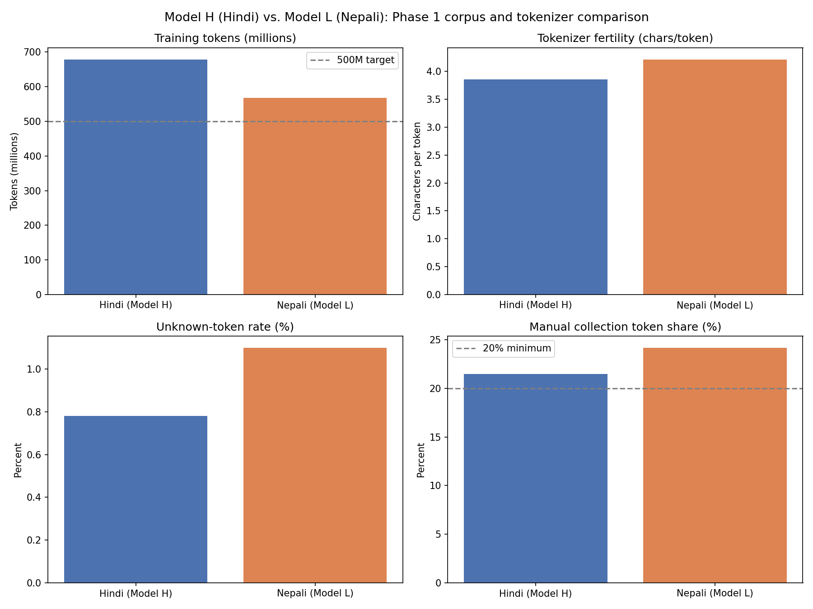

# Phase 1 Comparison Report: Model H (Hindi) vs. Model L (Nepali)

This report puts the two languages side by side. The individual, more detailed
reports are [`stats_hindi.md`](stats_hindi.md) and [`stats_nepali.md`](stats_nepali.md) —
this one is just about comparing them and explaining why the numbers turned out
the way they did.

To be clear up front: **the two corpora and tokenizers are completely
independent.** I collected them separately, cleaned them separately, and trained
the tokenizers separately with no shared vocabulary. I actually checked
this directly — see Section 5 below.

## 1. The two models at a glance

| | Hindi (Model H) | Nepali (Model L) |
| --- | --- | --- |
| Resource tier | Higher-resource | Lower-resource (from the assignment's allowed list) |
| Raw documents collected | 8,878,491 | 12,159,484 |
| Documents kept after cleaning | 4,686,338 (52.8%) | 5,154,832 (42.4%) |
| Train / val / test documents | 4,592,126 / 47,287 / 46,925 | 5,051,679 / 51,458 / 51,695 |
| Vocabulary size | 9,000 | 9,000 |
| Training tokens (exact) | 679,019,018 | 568,348,098 |
| Fertility (chars/token) | 3.86 | 4.22 |
| Unknown-token rate | 0.78% | 1.10% |
| Manual token share | 21.5% | 24.2% |
| Meets ~500M token target | Yes | Yes |
| Meets 20% manual minimum | Yes | Yes |

## 2. Why Nepali kept fewer documents through cleaning

Nepali actually started with *more* raw documents than Hindi (12.2 million vs
8.9 million), but ended up with a lower keep-rate after cleaning (42.4% vs
52.8%). Almost all of that gap comes from one filter: the 200-character length
cutoff. A much bigger share of Nepali's raw IndicCorp data turned out to be short
fragments rather than full articles or paragraphs, compared to Hindi's raw data.
This isn't a bug in the pipeline — it's just what the two source corpora actually
look like. IndicCorpV2's Hindi shard and Nepali shard weren't built from exactly
the same mix of sources, so their length distributions differ.

## 3. Why Nepali's fertility and unknown-token rate are both a bit worse

At the same vocabulary size (9,000), Nepali needs more tokens per character of
text (4.22 vs 3.86), and its unknown-token rate is higher (1.10% vs 0.78%). Both
numbers point at the same underlying thing: Nepali's training data is smaller and
less varied than Hindi's, even after I went back and added more IndicCorp data
to hit the token target. A tokenizer trained on a smaller, less diverse corpus has
less material to learn an efficient shared vocabulary from, so it ends up needing
more, shorter pieces to cover the same amount of text, and it's a bit more likely
to run into subword patterns it hasn't seen often enough.

This is expected, and honestly it's kind of the point — I picked Nepali
specifically because it's the lower-resource language for this project. Seeing
that gap show up cleanly in the tokenizer numbers is a good sanity check that the
pipeline is measuring something real, not just noise.

## 4. Why both languages use the same vocabulary size

I could have picked a different, "locally optimal" vocabulary size for each
language based on its own fertility curve. I chose not to. Both models use
9,000, on purpose, for one main reason: this project isn't just about building
two tokenizers, it's about comparing Model H and Model L later on — perplexity,
bits-per-byte, generation quality, all of it. If Hindi and Nepali started with
different-sized vocabularies, any difference I saw in those later comparisons
could always be explained away as "well, maybe it's just the vocab size, not the
actual resource gap." Keeping the vocabulary size fixed removes that as a
confound. Whatever differences show up later should be about the actual data and
language differences, not an accident of tokenizer configuration.

The full reasoning behind picking 9,000 specifically — including the parameter
budget math for Phase 2's ~25M-parameter model — is in Section 6 of each
individual report (it's the same argument for both languages, since they share
the same parameter budget and just differ in fertility).

## 5. Corpus independence — actually checked, not assumed

The assignment requires that Model H and Model L never share data. I didn't just
assume this because I collected them from different sources — I checked it
directly. I hashed every cleaned document (both languages), and compared the two
sets of hashes for overlap.

| | Value |
| --- | --- |
| Hindi documents (hashed) | 4,686,338 |
| Nepali documents (hashed) | 5,154,832 |
| Documents shared between the two | 0 |
| Fully independent? | Yes |

Full result: [`corpus_independence.json`](corpus_independence.json).

## 6. What this means going into Phase 2

Hindi has more training data, better fertility, and a lower unknown-token rate.
None of that is surprising — it's the higher-resource language by design. The
interesting question for Phase 2 and Phase 3 isn't "which model performs better"
(Hindi almost certainly will, on raw language-modeling metrics), it's *how much*
better, and whether that gap tracks cleanly with the data-quantity gap seen here,
or whether something else (script complexity, tokenizer fertility, training
signal quality) turns out to matter more than raw token count. Having these
Phase 1 numbers pinned down now — same vocab size, both corpora independently
verified, both clearing the 500M token and 20% manual requirements — means that
comparison in Phase 2 will actually be measuring something meaningful instead of
being muddied by mismatched starting conditions.
