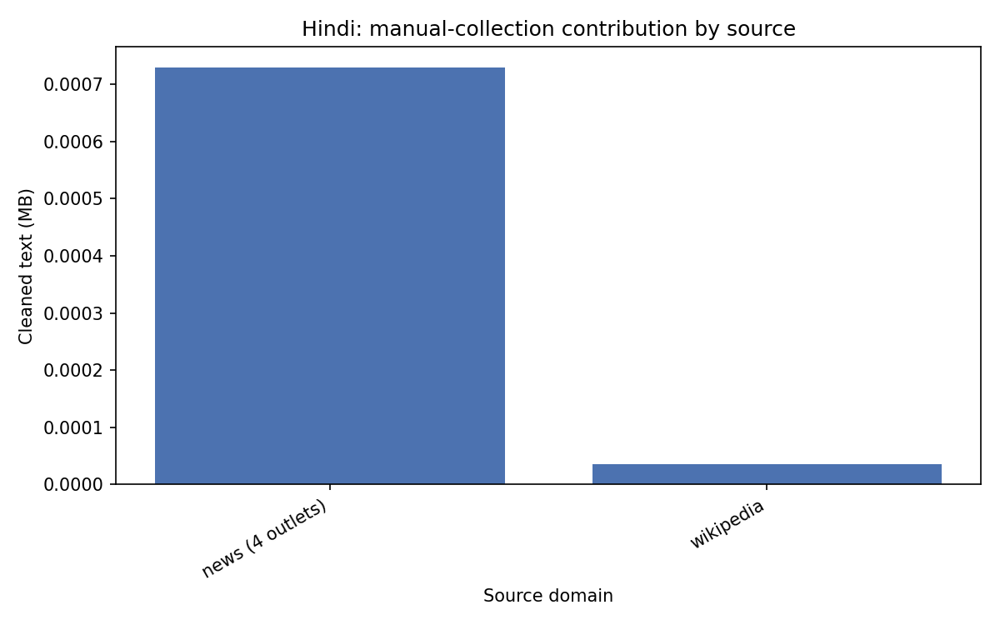
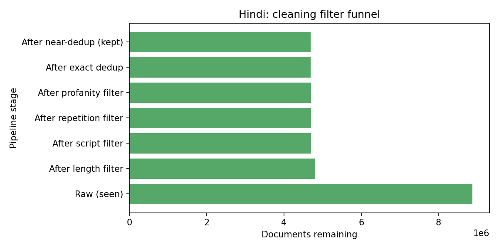
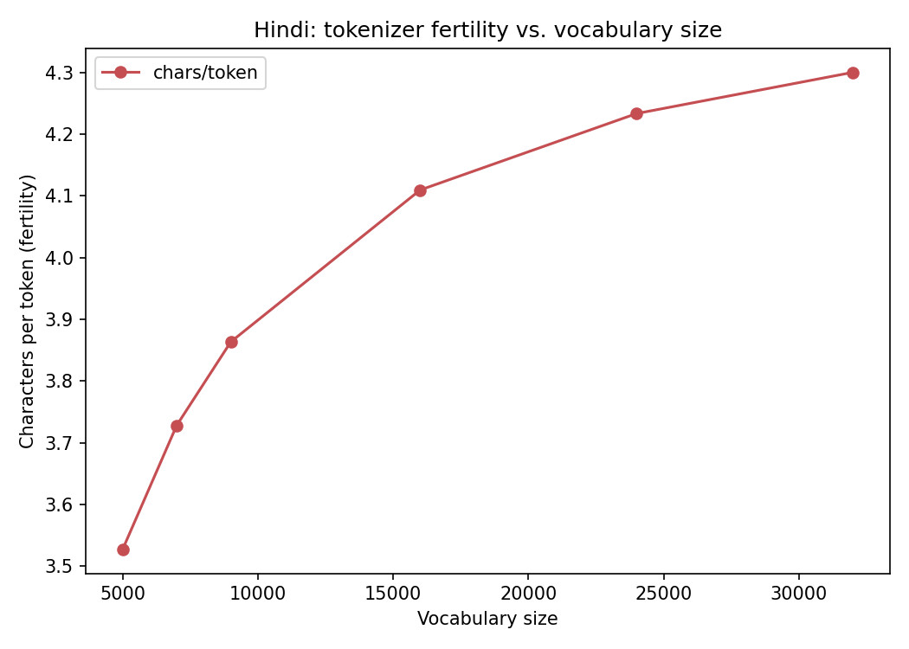
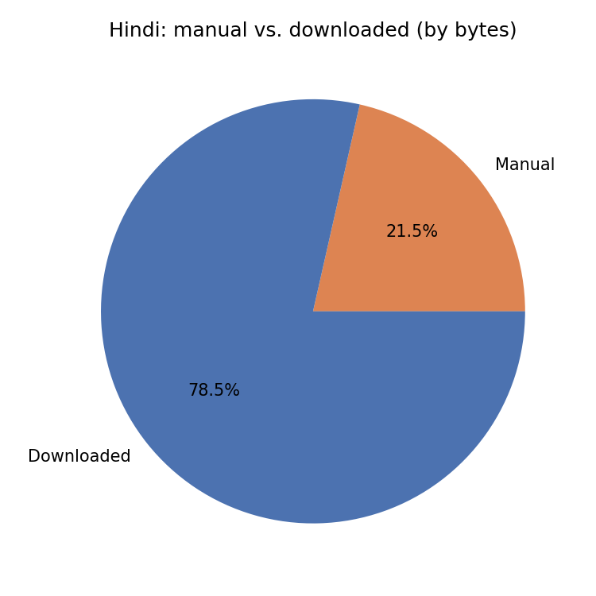

# Phase 1 Report: Hindi (Model H)

This is the higher-resource language in my project. Below is everything about
how I collected, cleaned, split, and turned the data into a tokenizer.

## 1. Where the data came from

| Source | Type | How I collected it |
| --- | --- | --- |
| zeenews.india.com, indiatv.in, jagran.com, patrika.com | Manual (news) | Crawled each site's sitemap to find article URLs, then pulled the article text. 2.5 requests/second per site so I don't hammer any one server. |
| hi.wikipedia.org | Manual (Wikipedia) | Pulled through the MediaWiki API. |
| AI4Bharat IndicCorpV2 (Hindi shard) | Public/downloaded | Downloaded directly from Hugging Face. |



## 2. Cleaning the data

Every document, whether it came from news, Wikipedia, or IndicCorp, goes through
the same cleaning steps, in this order:

1. **Unicode normalization** — fixes inconsistent encodings of the same character
   and removes stray control characters.
2. **Length filter** — drop anything under 200 characters. Too short to be a real
   article.
3. **Script filter** — the text has to be at least 70% Devanagari letters, and no
   more than 15% Latin letters. This throws out pages that are mostly English or
   navigation menus.
4. **Repetition filter** — drops documents that are basically one line or phrase
   repeated over and over. This catches template/boilerplate junk that slips past
   the script filter because it's technically valid Hindi text.
5. **Profanity filter** — drops documents where a large chunk of the text is
   blocklisted words. I check this as whole words, not substrings, so I don't
   accidentally flag a normal word that happens to contain a bad substring.
6. **Decontamination check** — this is meant to make sure none of the Phase 3
   evaluation data leaks into training. Since Phase 3 doesn't exist yet, this step
   currently does nothing, but I've already wired the code in for when I need it.
7. **Exact duplicate removal** — if two documents have the exact same text (by
   hash), I only keep the first one.
8. **Near-duplicate removal** — this catches documents that are almost identical
   but not word-for-word (like the same news story republished by two outlets
   with a different byline). This only runs on the manually-crawled news and
   Wikipedia data, not on the IndicCorp data — running it on all ~8.5 million
   IndicCorp documents would need more memory than this machine has (~7GB RAM).
   IndicCorp is already deduplicated by AI4Bharat before it's published, so this
   isn't a real gap in the pipeline, just a scoping decision I made to fit the
   available memory.

### How many documents survived each step

| Step | Documents left |
| --- | --- |
| Raw, before cleaning | 8,878,491 |
| After length filter | 4,810,881 |
| After script filter | 4,699,561 |
| After repetition filter | 4,698,164 |
| After profanity filter | 4,698,077 |
| After decontamination check (no-op) | 4,698,077 |
| After exact-duplicate removal | 4,687,493 |
| After near-duplicate removal (final) | 4,686,338 |



Most of the loss happens at the length filter — a lot of raw IndicCorp lines are
short fragments, not full articles.

## 3. What the cleaned corpus looks like

| | Value |
| --- | --- |
| Total documents | 4,686,338 |
| Total size | 6,830.3 MB |
| From manual collection | 239,169 documents |
| From IndicCorp | 4,447,169 documents |

## 4. Train / validation / test split

I split documents by hashing their document ID: `sha256(doc_id) % 100`. Buckets
0–97 go to train, 98 to validation, 99 to test. This is deterministic — running it
again gives the exact same split without needing to save anything — and it means
no single article ever ends up split across two different sets.

| Split | Documents | Size (bytes) | % of documents |
| --- | --- | --- | --- |
| Train | 4,592,126 | 6,693,624,482 | 97.98% |
| Validation | 47,287 | 68,063,186 | 1.01% |
| Test | 46,925 | 68,649,091 | 1.00% |

## 5. Tokenizer

I used **SentencePiece Unigram**, not BPE. Hindi words change a lot depending on
grammar (case endings, verb forms), and Unigram tends to find subword pieces that
line up with those meaningful chunks better than BPE's simpler merge-based
approach. I also turned on byte-fallback, which means the tokenizer can
technically encode any input — even a completely unseen character — by falling
back to raw bytes if needed.

### Picking the vocabulary size

Before training the final tokenizer, I swept across six candidate vocabulary
sizes and measured **fertility** — the average number of characters each token
represents — on the held-out validation text. A higher fertility number means
fewer, longer tokens for the same amount of text.

I trained on a sample of 250,000 training documents. I originally planned to use a
much bigger sample (1.5 million documents), but the tokenizer trainer kept getting
killed by the operating system for using too much memory (~5.4GB peak on a machine
with about 7GB total). I tried a smaller sample size a couple of times before
settling on 250,000, which trained reliably.

| Vocabulary size | Tokens on val set | Fertility (chars/token) |
| --- | --- | --- |
| 5,000 | 7,548,434 | 3.53 |
| 7,000 | 7,141,244 | 3.73 |
| **9,000** | **6,891,072** | **3.86** |
| 16,000 | 6,478,368 | 4.11 |
| 24,000 | 6,288,829 | 4.23 |
| 32,000 | 6,191,102 | 4.30 |



I picked **9,000** as the final vocabulary size. Section 6 below explains why.

### The final tokenizer's numbers

Trained at vocab size 9,000, then run over the entire training split (not the
sample used for the sweep) to get exact numbers:

| | Value |
| --- | --- |
| Vocabulary size | 9,000 |
| Documents tokenized | 4,592,126 |
| Characters | 2,618,665,405 |
| **Tokens (exact count)** | **679,019,018** |
| Fertility | 3.86 chars/token |
| Unknown-token rate | 0.78% |

**679 million tokens is above the assignment's 500 million target for Hindi.**

To check the unknown-token rate honestly, I trained a second, throwaway tokenizer
at the same vocab size but with byte-fallback turned off, so it's forced to
actually emit an unknown-token symbol instead of quietly falling back to bytes.
That gave me 0.78% — meaning less than 1 in 100 tokens would have been unknown if
byte-fallback didn't exist as a safety net. That's a good sign that 9,000 pieces
is enough to cover almost all the common subword patterns in this corpus.

### What's actually in the vocabulary

SentencePiece assigns lower piece IDs to more common pieces (roughly). Right after
the special tokens (`<unk>`, `<s>`, `</s>`) come 256 byte-fallback pieces
(`<0x00>` through `<0xFF>`), and then the actual learned vocabulary starts:

| Piece ID | Piece | What it is |
| --- | --- | --- |
| 0 | `<unk>` | special token |
| 1 | `<s>` | special token |
| 2 | `</s>` | special token |
| 3–258 | `<0x00>`–`<0xFF>` | byte-fallback (256 of these) |
| 500 | `▁अस्पताल` (hospital) | common word |
| 1000 | `▁पड़ा` (had to / fell) | common word |
| 5000 | `▁सतर्क` (alert) | less common word |
| 8999 | `ञ` (a Devanagari letter) | rare, near the end of the vocabulary |

Early in the vocabulary (right after the byte-fallback pieces) you mostly see
whole common words and short suffixes. Toward the end, it's mostly single
characters and rarer word fragments. That's the shape you'd expect from a Unigram
tokenizer at this vocabulary size.

### A few example sentences, tokenized

```
देश की राजधानी दिल्ली से हत्या का एक सनसनीखेज मामला सामने आया है। पारिवारिक विवाद के चलते 17 वर्षीय
→ ▁देश ▁की ▁राजधानी ▁दिल्ली ▁से ▁हत्या ▁का ▁एक ▁सनसनी ख ेज ▁मामला ▁सामने ▁आया ▁है । ▁पारिवारिक ▁विवाद ▁के ▁चलते ▁17 ▁वर्षीय
(20 pieces / 100 characters)

भारत एक विविधतापूर्ण देश है जहाँ अनेक भाषाएँ बोली जाती हैं।
→ ▁भारत ▁एक ▁विवि ध ता पूर्ण ▁देश ▁है ▁जहाँ ▁अनेक ▁भाषा एँ ▁बोली ▁जाती ▁हैं ।
(16 pieces / 60 characters)

नई दिल्ली में आज भारी बारिश हुई और यातायात व्यवस्था बुरी तरह प्रभावित हुई।
→ ▁नई ▁दिल्ली ▁में ▁आज ▁भारी ▁बारिश ▁हुई ▁और ▁यातायात ▁व्यवस्था ▁बुरी ▁तरह ▁प्रभावित ▁हुई ।
(15 pieces / 75 characters)
```

Common short words (की, के, है, और, से, का, में) always come out as a single
token. Longer or less common words get split up — सनसनीखेज (sensational) becomes
सनसनी + ख + ेज, and विविधतापूर्ण (diverse) becomes विवि + ध + ता + पूर्ण. That's
normal for a tokenizer at this size, and it's noticeably less fragmented than what
I saw when I first tried a smaller vocabulary of 5,000.

## 6. Why vocabulary size 9,000?

Looking at just the fertility numbers, bigger vocabularies are always better —
fewer, more meaningful tokens per document. But bigger vocabularies aren't free.
In Phase 2, the model has to fit in roughly 25 million parameters total, and the
token embedding table plus the output layer both scale directly with vocabulary
size. If those two layers aren't tied together (sharing the same weights), a
bigger vocabulary eats directly into how many parameters are left for the actual
Transformer layers that do the real language modeling.

Here's roughly how much of a 25M-parameter budget each vocabulary size would use,
assuming the embedding and output layers are tied:

| Vocabulary size | Params at d=256 | Params at d=384 | % of 25M budget (at d=384) |
| --- | --- | --- | --- |
| 5,000 | 1.28M | 1.92M | ~7.7% |
| 7,000 | 1.79M | 2.69M | ~10.8% |
| **9,000** | **2.30M** | **3.46M** | **~13.8%** |
| 16,000 | 4.10M | 6.14M | ~24.6% |
| 24,000 | 6.14M | 9.22M | ~36.9% |
| 32,000 | 8.19M | 12.29M | ~49.2% |

At 32,000, nearly half the whole model's parameter budget would just be
vocabulary lookup, leaving very little for the layers that actually process
language. Even at 16,000, that's about a quarter of the budget gone before a
single Transformer block is built.

So the real tradeoff is: a smaller vocabulary frees up more parameters for the
model itself, but costs more tokens per document (longer sequences, more compute
per training step, since attention cost grows quadratically with sequence
length). A bigger vocabulary makes sequences shorter and cheaper to process, but
eats into the parameter budget the model actually needs to learn with.

I started this project with vocab size 5,000, since it uses the fewest
parameters. But after thinking it through more, I moved up to **9,000**. It only
costs about 0.8M more parameters than 5,000 would have, but the fertility
improves meaningfully — from 3.53 to 3.86 chars/token, which is roughly 9% fewer
tokens for the same amount of text. It's a middle ground: nowhere near as
expensive as 16,000+, but noticeably more efficient than 5,000. The unknown-token
rate at this size (0.78%) also confirms the vocabulary is still large enough to
cover the corpus well.

## 7. Manual vs. downloaded, in tokens

The assignment specifically wants this reported in **tokens**, not documents or
bytes, since manual and downloaded text don't have the same average length. I
measured this by running the final tokenizer over the whole training split and
counting tokens separately for each source:

| Source | Documents | Tokens | Share |
| --- | --- | --- | --- |
| Manual (news + Wikipedia) | 234,394 | 145,730,027 | **21.5%** |
| IndicCorp (downloaded) | 4,357,732 | 533,288,991 | 78.5% |
| **Total** | 4,592,126 | 679,019,018 | 100% |



21.5% manual clears the assignment's 20% minimum requirement.

## 8. Summary

| Metric | Value |
| --- | --- |
| Raw documents collected | 8,878,491 |
| Documents after cleaning | 4,686,338 (52.8% kept) |
| Train / val / test documents | 4,592,126 / 47,287 / 46,925 |
| Tokenizer | SentencePiece Unigram, byte-fallback on |
| Vocabulary size | 9,000 |
| Training tokens (exact) | 679,019,018 |
| Fertility | 3.86 chars/token |
| Unknown-token rate (measured without fallback) | 0.78% |
| Manual token share | 21.5% |
| Hits the ~500M token target? | Yes — 679.0M |
| Hits the 20% manual minimum? | Yes — 21.5% |

A side-by-side comparison between Hindi and Nepali, with a discussion of why the
numbers differ the way they do, is in
[`comparison_report.md`](comparison_report.md).
