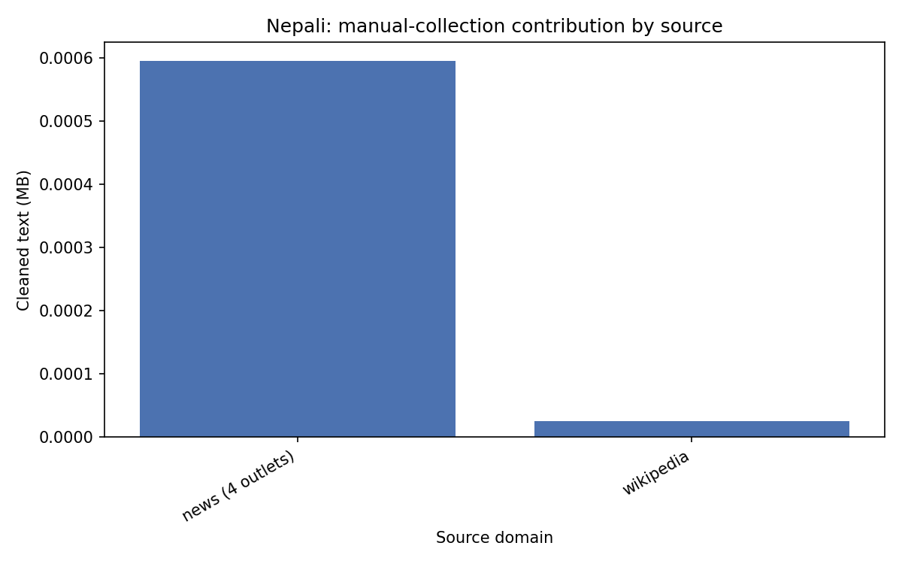
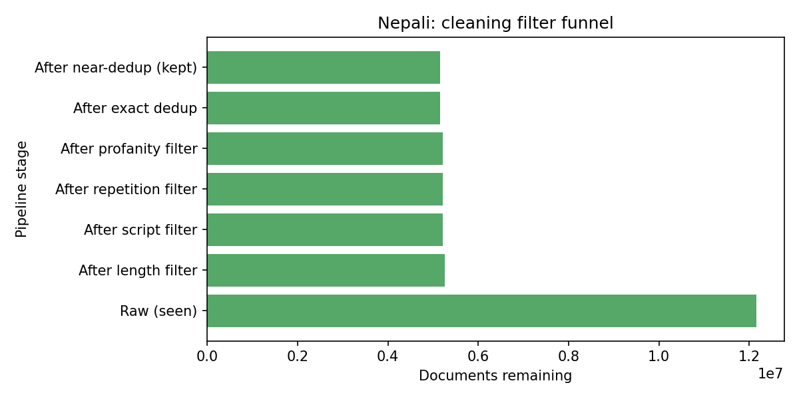
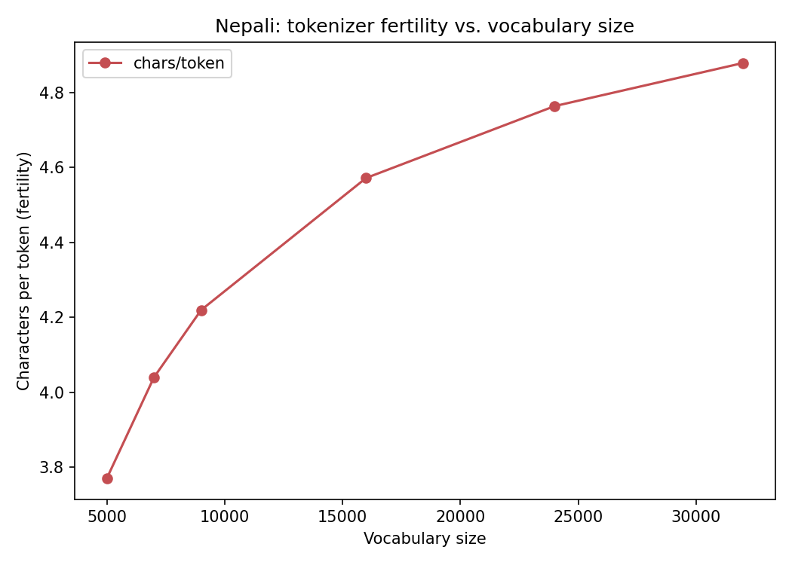
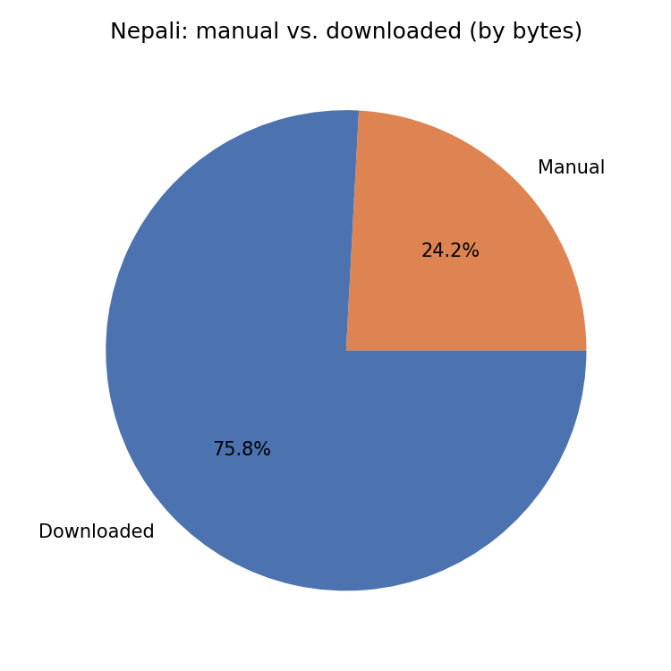

# Phase 1 Report: Nepali (Model L)

This is the lower-resource language in my project, picked from the assignment's
allowed list. Below is everything about how I collected, cleaned, split, and
turned the data into a tokenizer.

## 1. Where the data came from

| Source | Type | How I collected it |
| --- | --- | --- |
| khabarhub.com, dcnepal.com, karobardaily.com, nepalnews.com | Manual (news) | Crawled each site's sitemap to find article URLs, then pulled the article text. 2.5 requests/second per site. |
| ne.wikipedia.org | Manual (Wikipedia) | Pulled through the MediaWiki API. |
| AI4Bharat IndicCorpV2 (Nepali shard) | Public/downloaded | Downloaded directly from Hugging Face. |

I tried one more site, `nepalpress.com`, and dropped it. Its sitemap looked fine
when I checked by hand, but the actual crawl kept getting 0 URLs back. It turned out
to be a Cloudflare protection rule blocking the specific sequence of requests my
crawler makes (checking robots.txt, then asking for the sitemap). Not worth
building a special workaround for one out of five candidate sites, so I left it
out.



## 2. Cleaning the data

Same cleaning pipeline as Hindi, run completely separately — I made sure Nepali's
cleaning run doesn't share any state, hashes, or intermediate files with Hindi's:

1. **Unicode normalization** — fixes inconsistent encodings, strips stray control
   characters.
2. **Length filter** — drop anything under 200 characters.
3. **Script filter** — needs to be at least 70% Devanagari letters, no more than
   15% Latin letters.
4. **Repetition filter** — drops documents that are mostly one repeated line or
   phrase.
5. **Profanity filter** — drops documents with a heavy concentration of
   blocklisted words (Nepali has its own separate blocklist, not shared with
   Hindi's).
6. **Decontamination check** — currently a no-op, same as Hindi, since Phase 3
   doesn't exist yet.
7. **Exact duplicate removal**.
8. **Near-duplicate removal** — only on manual news and Wikipedia data, for the
   same memory reasons explained in the Hindi report (Section 2).

### A note on how the Nepali data grew mid-project

My first pass through this pipeline used a 5.4GB slice of IndicCorpV2's Nepali
file (out of about 14.77GB total available on Hugging Face) and ended up with
475.2 million training tokens — about 95% of the 500 million target. Since there
was clearly more of the source file available, I downloaded an extra 1.5GB
(bringing the total to 6.9GB) and reran the whole pipeline — import, clean, split,
tokenizer — from scratch. That pushed the token count up to 568.3 million, past
the target. The numbers below are from this final, expanded run (12,159,484 raw
documents, up from 9,598,902 the first time).

### How many documents survived each step

| Step | Documents left |
| --- | --- |
| Raw, before cleaning | 12,159,484 |
| After length filter | 5,253,868 |
| After script filter | 5,220,034 |
| After repetition filter | 5,219,878 |
| After profanity filter | 5,219,448 |
| After decontamination check (no-op) | 5,219,448 |
| After exact-duplicate removal | 5,157,530 |
| After near-duplicate removal (final) | 5,154,832 |



## 3. What the cleaned corpus looks like

| | Value |
| --- | --- |
| Total documents | 5,154,832 |
| Total size | 6,539.2 MB |
| From manual collection | 337,473 documents |
| From IndicCorp | 4,817,359 documents |

## 4. Train / validation / test split

Same scheme as Hindi: `sha256(doc_id) % 100`, buckets 0–97 go to train, 98 to
validation, 99 to test.

| Split | Documents | Size (bytes) | % of documents |
| --- | --- | --- | --- |
| Train | 5,051,679 | 6,408,408,719 | 97.99% |
| Validation | 51,458 | 65,180,358 | 1.00% |
| Test | 51,695 | 65,634,340 | 1.00% |

## 5. Tokenizer

Same choice as Hindi: **SentencePiece Unigram**, with byte-fallback turned on.
Nepali is also a Devanagari, morphologically rich language, so the same reasoning
applies — Unigram tends to find subword pieces that line up better with real
morpheme boundaries than BPE does.

### Picking the vocabulary size

Same sweep process as Hindi: six candidate vocabulary sizes, trained on a
250,000-document sample, fertility measured on held-out validation text. (I cut
the sample size down from an original plan of 1.5 million documents after the
tokenizer trainer repeatedly got killed for using too much memory — full story in
the Hindi report, Section 5.)

| Vocabulary size | Tokens on val set | Fertility (chars/token) |
| --- | --- | --- |
| 5,000 | 5,400,856 | 3.77 |
| 7,000 | 5,040,209 | 4.04 |
| **9,000** | **4,825,592** | **4.22** |
| 16,000 | 4,453,391 | 4.57 |
| 24,000 | 4,273,914 | 4.76 |
| 32,000 | 4,172,982 | 4.88 |



I picked **9,000** here too, to match Hindi. Section 6 explains why.

### The final tokenizer's numbers

Trained at vocab size 9,000, then run over the whole training split for exact
numbers:

| | Value |
| --- | --- |
| Vocabulary size | 9,000 |
| Documents tokenized | 5,051,679 |
| Characters | 2,396,753,494 |
| **Tokens (exact count)** | **568,348,098** |
| Fertility | 4.22 chars/token |
| Unknown-token rate | 1.10% |

**568 million tokens is above the 500 million target.**

I measured the unknown-token rate the same way as for Hindi — a throwaway
tokenizer trained at the same size with byte-fallback off, to get a real
out-of-vocabulary signal. Nepali's rate (1.10%) is a bit higher than Hindi's
(0.78%) at the same vocabulary size. That fits the general picture: Nepali has
less training data to work with, so the same-size vocabulary ends up covering a
slightly smaller fraction of the language's actual subword patterns.

### What's actually in the vocabulary

| Piece ID | Piece | What it is |
| --- | --- | --- |
| 0 | `<unk>` | special token |
| 1 | `<s>` | special token |
| 2 | `</s>` | special token |
| 3–258 | `<0x00>`–`<0xFF>` | byte-fallback (256 of these) |
| 500 | `▁उनी` (he/she) | common word |
| 1000 | `▁बे` (common prefix fragment) | common piece |
| 5000 | `▁प्रष्ट` (clear/explicit) | less common word |
| 8999 | `F` (a Latin letter) | rare, near the end |

Same pattern as Hindi: whole words and common fragments near the front of the
vocabulary, single characters and rare pieces toward the end.

### A few example sentences, tokenized

```
चीन भ्रमण सफल भएको प्रधानमन्त्री ओलीको दावी
→ ▁चीन ▁भ्रमण ▁सफल ▁भएको ▁प्रधानमन्त्री ▁ओलीको ▁दावी
(7 pieces / 43 characters)

बार्सिलोनाद्वारा सलाहलाई विश्वकै महँगो खेलाडी बनाएर किन्ने प्रस्ताव
→ ▁बार्सिलोना द्वारा ▁स ला ह लाई ▁विश्व कै ▁महँगो ▁खेलाडी ▁बनाएर ▁किन्न े ▁प्रस्ताव
(14 pieces / 67 characters)

विश्व विजेता फ्रान्स समूहचरणबाटै बाहिरिएको जर्मनीसँग बराबरीमा रोकियो
→ ▁विश्व ▁विजेता ▁फ्रान्स ▁समूह च रण बाटै ▁बाहिरिए को ▁जर्मनी सँग ▁बराबरीमा ▁रोक ियो
(14 pieces / 68 characters)
```

Short common words (चीन, सफल, विश्व) come out as single tokens. Longer or
compound words get broken up — समूहचरणबाटै (group-stage-through) splits into
समूह + च + रण + बाटै. Something interesting here: Nepali's postposition-like
suffixes (things like द्वारा "by/through", लाई "to/for", सँग "with") often break
off cleanly as their own piece, which matches how Nepali attaches these little
grammatical markers onto words.

## 6. Why I chose vocabulary size 9,000

Same tradeoff as explained in the Hindi report: bigger vocabularies give better
fertility (fewer tokens per document), but eat into the fixed ~25M parameter
budget that Phase 2's model has to work with, since the token embedding and
output layers scale directly with vocabulary size.

| Vocabulary size | Params at d=256 | Params at d=384 | % of 25M budget (at d=384) |
| --- | --- | --- | --- |
| 5,000 | 1.28M | 1.92M | ~7.7% |
| 7,000 | 1.79M | 2.69M | ~10.8% |
| **9,000** | **2.30M** | **3.46M** | **~13.8%** |
| 16,000 | 4.10M | 6.14M | ~24.6% |
| 24,000 | 6.14M | 9.22M | ~36.9% |
| 32,000 | 8.19M | 12.29M | ~49.2% |

I picked **9,000** here to match Hindi's vocabulary size, on purpose. Nepali's
fertility at 9,000 (4.22 chars/token) is a bit worse than Hindi's (3.86) at the
same size — which makes sense, since Nepali's training corpus is smaller and
gives the tokenizer trainer less material to work with. But keeping both
languages at the same vocabulary size, rather than letting each pick its own
"optimal" size independently, matters for Phase 2 and 3: when I compare Model H
and Model L later (perplexity, bits-per-byte, generation quality), I want any
difference I see to actually be about the languages and their data, not an
artifact of one model starting with a bigger or smaller vocabulary than the
other. The unknown-token rate at 9,000 (1.10%) confirms the vocabulary is still
plenty big enough for Nepali.

## 7. Manual vs. downloaded, in tokens

| Source | Documents | Tokens | Share |
| --- | --- | --- | --- |
| Manual (news + Wikipedia) | 330,718 | 137,301,817 | **24.2%** |
| IndicCorp (downloaded) | 4,720,961 | 431,046,281 | 75.8% |
| **Total** | 5,051,679 | 568,348,098 | 100% |



24.2% manual clears the 20% minimum, and it's actually a bit higher than Hindi's
21.5%. Worth noting: the manual token count here didn't change when I expanded
the corpus to close the token gap — only the IndicCorp side grew. So the manual
share dropped from what it was in my first pass (28.9%) down to 24.2%, but it's
still comfortably above the floor.

## 8. Summary

| Metric | Value |
| --- | --- |
| Raw documents collected | 12,159,484 |
| Documents after cleaning | 5,154,832 (42.4% kept) |
| Train / val / test documents | 5,051,679 / 51,458 / 51,695 |
| Tokenizer | SentencePiece Unigram, byte-fallback on |
| Vocabulary size | 9,000 |
| Training tokens (exact) | 568,348,098 |
| Fertility | 4.22 chars/token |
| Unknown-token rate (measured without fallback) | 1.10% |
| Manual token share | 24.2% |
| Hits the ~500M token target? | Yes — 568.3M |
| Hits the 20% manual minimum? | Yes — 24.2% |

A side-by-side comparison between Hindi and Nepali, with a discussion of why the
numbers differ the way they do, is in
[`comparison_report.md`](comparison_report.md).
