# Phase 2 Report — Model Implementation, Pretraining, and Evaluation

This report covers everything I did in Phase 2: building a Transformer language
model completely from scratch, training two independent copies of it (one for
Hindi, one for Nepali), and then evaluating both to see what they actually
learned.

Throughout, **Model H** means the Hindi model (the higher-resource language) and
**Model L** means the Nepali model (the lower-resource one, picked from the
assignment's allowed list). It's worth saying clearly up front: these are not two
versions of the same model, and they don't share anything. Different training data,
different tokenizers (built separately in Phase 1, different vocabularies), and
completely separate weights trained from separate random initializations. Neither
model ever saw the other model's data, and I never initialized one from the
other's weights. The only thing they share is the *code* — the architecture
class, the training loop, the hyperparameters — because the point of the
assignment is to compare two resource tiers using the same recipe, not to
compare two different recipes.

---

## 1. How I built the model, and why I chose each piece the way I did

Before getting into numbers, it's worth actually walking through what this model
is, piece by piece, because the assignment specifically wants to know *why* I made
each choice, not just what the choice was. I'll go through it roughly in the
order data flows through the network: tokens go in, they get turned into vectors,
those vectors pass through a stack of identical blocks, and at the end I get a
prediction for what token comes next.

### 1.1 Turning tokens into vectors

The very first thing that happens is that a sequence of token IDs (integers,
produced by the SentencePiece tokenizer from Phase 1) gets mapped to a sequence of
dense vectors. This is just a lookup table — an embedding matrix of shape
`(vocab_size, d_model)` — where token ID `k` maps to row `k`. Nothing clever here,
it's the standard first step for basically any neural network that works on
discrete tokens.

### 1.2 Where does the model learn about *order*?

This is the first genuinely interesting design decision, and it's one the
assignment explicitly asks to be justified. Here's the problem: self-attention
(described in the next section) is, by itself, completely blind to word order. If
you feed it the sentence "the dog bit the man" and "the man bit the dog", and you
don't do anything special, attention treats both sentences as the same *set* of
tokens — it has no built-in notion that "dog" came before "bit" came before "man".
Attention just computes how much every token should "listen to" every other token,
and that computation, on its own, is symmetric with respect to position — shuffle
the input tokens and shuffle the output the same way, and you get the same
numbers back. Position has to be injected deliberately, or the model literally
cannot tell these two sentences apart.

There are three common ways to do this, and the assignment says to pick one and
explain the choice, so here's what I considered:

1. **Learned absolute position embeddings.** Have a second lookup table, this
   time indexed by *position* rather than by *token identity* — position 0 gets
   its own learned vector, position 1 gets a different learned vector, and so on
   up to `max_seq_len`. Add this to the token embedding. Simple, and it works, but
   it means the model has to learn, from scratch, purely from data, what "being at
   position 47" means — and it has zero ability to generalize to position 48 if it
   never saw many examples with something interesting happening exactly there.
2. **Sinusoidal position encoding.** Instead of learning the position vectors,
   compute them with a fixed formula (sines and cosines at different
   frequencies) and add that to the token embedding. No extra parameters to
   learn, and the fixed mathematical structure means nearby positions naturally
   get similar-looking codes. This is what the original "Attention Is All You
   Need" paper used, and it's what I used in an earlier version of this project
   before making the change described below.
3. **RoPE (Rotary Position Embeddings).** This is what I actually shipped, and
   it works quite differently from the first two. Instead of *adding* a
   positional vector to the token embedding once, before the attention layers
   even see the data, RoPE *rotates* the query and key vectors, inside every
   single attention layer, by an angle that depends on their position in the
   sequence. There's no separate positional embedding table at all — position
   only ever shows up as a rotation applied right before the attention score is
   computed.

**Why I chose RoPE over the other two.** The core reason is that RoPE gives
the model *relative* position information directly, as a mathematical
consequence of how it's built, rather than hoping the model learns to extract
relative position from an absolute additive signal. Here's the intuition: if you
rotate the query vector at position `i` by angle `i·θ`, and you rotate the key
vector at position `j` by angle `j·θ`, then when you take their dot product (which
is what attention actually computes to decide "how much should token i attend to
token j"), the two rotations partially cancel out, and what's left over depends
only on the *difference* `i − j`, not on `i` and `j` individually. In other
words, the attention score between "position 10 attending to position 7" and
"position 103 attending to position 100" comes out mathematically identical
(same relative offset of 3), even though the model never explicitly computed
"distance 3" — it just falls out of the rotation math. With additive absolute
embeddings, the model has to *learn*, purely from gradient descent, that
position-10-vector combined-with position-7-vector should behave similarly to
position-103-vector combined-with-position-100-vector — nothing about the
representation forces that similarity, so the model has to work it out
statistically from however many examples of "a word 3 positions back" it happens
to see during training. RoPE builds the relationship in structurally, so it's not
something the model has to rediscover — which is exactly why I preferred it here.

A second, smaller reason: RoPE, like sinusoidal encoding, adds **zero extra
learnable parameters** — at a fixed 25M-parameter budget, every parameter spent
on a learned position table is a parameter not spent on the parts of the network
that actually process content, so getting positional information "for free" is
worth something at this scale.

**The cost, and it's the same cost every fixed-table scheme here pays**: RoPE's
rotation angles come from a table that's only computed out to `max_seq_len=256`
positions. Feed the model a sequence longer than that and there's no rotation
angle defined past position 256 — this is the model's hard context-length
ceiling, baked in by construction, not a soft guideline. (There exist RoPE
variants designed to extrapolate past their training length, but I didn't
attempt that here — I kept it as a fixed, honest cap.)

### 1.3 Self-attention, actually explained

This is the mechanism that lets the model figure out which earlier words in a
sentence are relevant to predicting the next word. I implemented it completely
from primitive PyTorch operations here — no `nn.MultiheadAttention`, no
`nn.Transformer` anything, every matrix multiply is written out by hand.

Here's the mechanism in plain terms. For every position in the sequence, the
model computes three different vectors out of that position's current
representation:

- A **query** vector — think of this as "what am I looking for?"
- A **key** vector — think of this as "what do I have to offer, if someone's
  looking for me?"
- A **value** vector — think of this as "here's the actual content I'll hand
  over if someone decides to attend to me."

These come from three separate learned linear projections of the input (in the
code they're computed together as one combined matrix multiply for efficiency,
then split apart — mathematically identical to three separate projections, just
one matrix instead of three).

Then, for every position, we compute how much it should "attend to" every other
position by taking the dot product of its query vector with every position's key
vector. A high dot product means "this query is looking for exactly what that key
is offering" — a strong match. These raw scores get divided by the square root
of the per-head dimension (more on why below), then a **causal mask** is applied
(more on that in a second), and then a softmax turns the scores into a proper
probability distribution — a set of weights, one per position, that sum to 1.
Finally, each position's output is just a weighted average of every other
position's *value* vector, using those attention weights.

**Why divide by √d_head?** This is a subtle but important detail. If you don't
rescale, the raw dot-product scores grow larger (in variance) as the vector
dimension grows — more dimensions means more terms getting summed into the dot
product, so the numbers get bigger just from having more dimensions, regardless
of how meaningful the match actually is. Once those scores get large enough,
softmax becomes almost a hard "pick the single best match and ignore everything
else" operation, because softmax is exponential — small differences in large
numbers turn into enormous differences in probability. That's bad for training,
because it means the gradient (the training signal) going back through the
softmax becomes extremely small almost everywhere except right at that one
dominant score — the network essentially stops learning from most of its
attention weights. Dividing by √d_head keeps the scores in a sane, roughly
constant-variance range no matter how large d_head is, so softmax stays in a
well-behaved regime where gradients can actually flow.

**What "causal" means, and why it matters so much for this project
specifically.** A causal (or "autoregressive") language model is only allowed to
look at tokens that came *before* the position it's currently predicting — it can
never see the future. This isn't optional or a minor detail; it's the entire
reason a decoder-only Transformer like this one can be used to generate text one
token at a time, left to right, the way GPT-style models do. If the model could
peek at position 6 while predicting position 5, training would be trivially easy
(the answer is right there) and generation at inference time would be completely
impossible (there is no future token to peek at yet, since you're generating it).
This is enforced with a mask — before the softmax, every score where the key
position is *later* than the query position gets set to negative infinity, so
after softmax those positions get exactly zero probability. No leakage is
mathematically possible.

**I actually tested this, not just assumed it works.** One of the required
checks in this project is to empirically verify the causal mask is doing its
job — my test literally changes the *last* token of an input sequence and
checks that logits at every *earlier* position stay bit-for-bit identical. If
changing a future token changed an earlier prediction, that would mean
information from the future leaked backward, which would be a serious
correctness bug. This test passes.

**Multiple heads, and why.** Rather than doing this whole query/key/value
process once with the full `d_model`-dimensional vectors, the model splits each
of Q, K, and V into 6 smaller chunks ("heads"), each of dimension
`d_head = d_model / n_heads = 384 / 6 = 64`, and runs the entire attention
computation independently, in parallel, within each of those 64-dimensional
subspaces. The intuition is that different heads can specialize — one head might
learn to always look one token back (useful for local grammar), another might
learn to look for the subject of the sentence regardless of distance (useful for
long-range agreement), and so on. If you forced everything through one single
384-dimensional attention computation, the model would have to represent all of
those different kinds of relationships in one shared space, which is a much
harder learning problem. After each head computes its own output, the 6 outputs
get concatenated back together and passed through one more learned linear layer
(the "output projection") that lets the model mix information across heads
before passing it on to the rest of the block.

### 1.4 The feed-forward network

After attention mixes information *across* positions, there's a second sublayer
in every block — the feed-forward network — that processes each position's
vector *independently*, with no mixing across positions at all. It's a simple
two-layer network: expand from `d_model=384` up to `d_ff=1536` (4× wider), apply
a GELU nonlinearity, then project back down to `384`. The intuition here is that
attention is good at *routing* information between positions, but relatively
limited in how much actual transformation/computation it does on that
information; the feed-forward layer is where most of the "thinking" — the
nonlinear transformation of features — actually happens. This 4× expansion ratio
is a very standard choice in Transformer architectures generally, not something
specific to this project, but I kept it because there wasn't a strong reason
to deviate from a well-established default at this scale.

### 1.5 Pre-norm vs. post-norm — the other required justification

Every block in the network needs to combine two things: the sublayer's own
computation (attention, or the feed-forward network) and a "residual"
connection that just passes the input straight through, added back on top of
whatever the sublayer computed. Residual connections are what let you actually
train deep networks at all — without them, gradients tend to vanish or explode
as they get backpropagated through many stacked layers, and the network becomes
very hard to train past a handful of layers.

There's a real choice about *where exactly* to put the LayerNorm relative to
that residual connection, and the two options are:

- **Post-norm**: `x = LayerNorm(x + Sublayer(x))` — do the sublayer's
  computation, add it to the input, *then* normalize the result. This is what
  the original Transformer paper did.
- **Pre-norm**: `x = x + Sublayer(LayerNorm(x))` — normalize the input *first*,
  feed the normalized version into the sublayer, and add the sublayer's output
  straight onto the *original, un-normalized* `x`.

**I chose pre-norm here, and the reasoning is about training stability at
this depth (13 layers).** With post-norm, the residual stream — the running sum
of everything added up so far — gets passed through a LayerNorm at every single
block. LayerNorm rescales its input, and doing that repeatedly, once per block,
means the "identity path" through the network (the thing that lets gradients
flow cleanly all the way back to the first layer) isn't actually a pure identity
anymore — it's an identity followed by a rescaling, at every layer, and those
rescalings compound. In practice this makes post-norm networks noticeably more
sensitive to the learning-rate warmup schedule, especially as depth increases;
get the warmup slightly wrong and training can become unstable or fail to
converge at all. Pre-norm avoids this by keeping the residual stream completely
untouched by any normalization — the *input to each sublayer* gets normalized,
but what actually gets added back to the running total is always the raw,
un-normalized sublayer output plus the raw, un-normalized previous value. This
gives the network a clean, literal identity path from the embeddings all the way
to the final layer, with gradients able to flow through plain addition rather
than through a normalization operation at every single block. At 13 layers, this
is a genuinely practical concern, not just a theoretical nicety — it removes one
whole axis of training instability to worry about while I was already juggling
everything else (a new architecture, a tight compute/time budget, two independent
models to train).

### 1.6 Tying the output layer to the input embedding

At the very end of the network, after the final LayerNorm, there's one more
linear layer that projects the `384`-dimensional hidden state back up to
`vocab_size=9000` dimensions — one score per possible next token. Rather than
learning this as a completely separate matrix, I made its weights literally the
same tensor as the input token-embedding matrix (transposed appropriately — both
matrices happen to be the exact same shape, `vocab_size × d_model`, since that's
how both `nn.Embedding` and `nn.Linear` store their weights internally). This is
called **weight tying**, and the intuition behind it is that a token's embedding
(its representation when it comes *in*) and its "how likely is this the right
next token" direction (its representation when it's predicted *out*) are
plausibly related concepts, so sharing the parameter is a reasonable inductive
bias, not just a memory-saving trick — though it is also a memory-saving trick:
it saves `vocab_size × d_model = 9000 × 384 = 3,456,000` parameters, which is
about 13% of the entire model's parameter budget. That's a meaningful chunk of
the 25M-parameter target freed up to spend elsewhere in the network instead.

### 1.7 Putting a number on the whole thing

| Hyperparameter | Value |
| --- | --- |
| `d_model` (hidden size) | 384 |
| `n_layers` (number of stacked blocks) | 13 |
| `n_heads` (attention heads per layer) | 6 (so `d_head` = 64) |
| `d_ff` (feed-forward inner width) | 1536 (4× `d_model`) |
| `max_seq_len` (context length) | 256 |
| `dropout` | 0.1 |
| **Trainable parameters (exact, counted in code, not estimated)** | **26,524,800** |

**Why I picked these exact numbers, and specifically why 13 layers.** The assignment
targets roughly 25 million parameters — enough to be a genuinely capable little
language model, small enough to actually train on free-tier GPU compute in a
reasonable amount of time. There are really two knobs available to hit that
target: make the model *wider* (bump up `d_model`) or make it *deeper* (stack
more layers). I decided the width first, for a reason that has
nothing to do with the parameter count directly: I chose `n_heads=6` because
it divides `d_model=384` evenly into `d_head=64`, and 64 is a clean, standard
per-head dimension — RoPE's rotation math specifically needs `d_head` to be even
(it works in 2D rotation pairs), and an ugly, non-round `d_head` would be an
unnecessary source of confusion when explaining the architecture. With
`d_model=384` and `d_ff` fixed at the conventional 4× expansion (giving 1536),
the only remaining free variable to reach the parameter target was the number of
layers. Twelve layers lands at 24,750,336 parameters — *under* the 25M floor by
about 250,000 parameters, which isn't a rounding error, it's a real shortfall
against an explicit requirement. Thirteen layers lands at 26,524,800 — comfortably
over the floor with a small, deliberate safety margin, not right at the edge
where a small counting mistake could put it under again.

Going deeper rather than wider, once I had to choose a layer count to hit the
target, was also a deliberate call on my part rather than an arbitrary one. More layers
means more sequential steps of computation the network gets to apply to its own
representation before producing an answer — each layer can build on what the
previous layer figured out. That extra "thinking depth" seemed like the more
useful thing to have given that in Phase 3 I plan to finetune the same
architecture on reasoning-style tasks (comparative/transitive reasoning,
"if A > B and B > C, which is smallest"), where being able to chain several
steps of inference matters more than having each individual step be very wide.
The alternative — fewer, wider layers — would have hit the same parameter count
with more capacity per layer but fewer opportunities to compose multiple
reasoning steps. Given the compute I had available (student-tier free GPU, CPU-only
local evaluation), the deeper/narrower point on that tradeoff curve felt like
the more considered choice for what I wanted this model to eventually be asked
to do, rather than just whatever configuration happened to land closest to 25M
first.

---

## 2. Pretraining — how the training actually went

I trained both models completely independently: same code, same
hyperparameters, but separate data, separate optimizer state, separate random
initialization. I used AdamW (Adam with decoupled weight decay — weight
decay is applied directly to the weights rather than folded into the gradient,
which behaves better in practice for Transformer-style models), a
linear-warmup-then-cosine-decay learning rate schedule, periodic validation
during training (not just at the end), and checkpoints that save absolutely
everything needed to resume — model weights, optimizer state (Adam's running
moment estimates, which matter a lot — resuming without them is not the same as
actually resuming, since Adam's effective per-parameter step size depends on
those running statistics, not just the raw learning rate), scheduler state, the
current training step, and the model config, all in one file, written
atomically so a crash mid-save can never leave a corrupted checkpoint behind.

| | Model H (Hindi) | Model L (Nepali) |
| --- | --- | --- |
| Training steps completed | 61,000 / 61,000 | 61,000 / 61,000 |
| Final train loss (last 10 logged steps, averaged) | 3.253 | 3.510 |
| Best validation loss reached during training | 3.136 | 3.441 |
| Best validation perplexity during training | ~23.0 | ~31.2 |
| Peak learning rate | 3.00 × 10⁻⁴ | 3.00 × 10⁻⁴ |
| Warmup steps | 1,000 | 1,000 |
| Batch size | 32 | 32 |

### 2.1 The training loss curves — what they actually show

The plots below are the single clearest piece of evidence that training worked
the way it was supposed to work. Each one has two things going on: a light, noisy
blue line (the raw training loss, logged every 50 steps — it's noisy because
each of those 50-step readings comes from a small, randomly-sampled batch of
text, so it jitters around) and a darker, smoothed blue line on top of it (a
20-step moving average, which cuts through that noise and shows the actual
trend). The orange dots are validation loss, checked periodically on held-out
data the model never trains on.

<p float="left">
  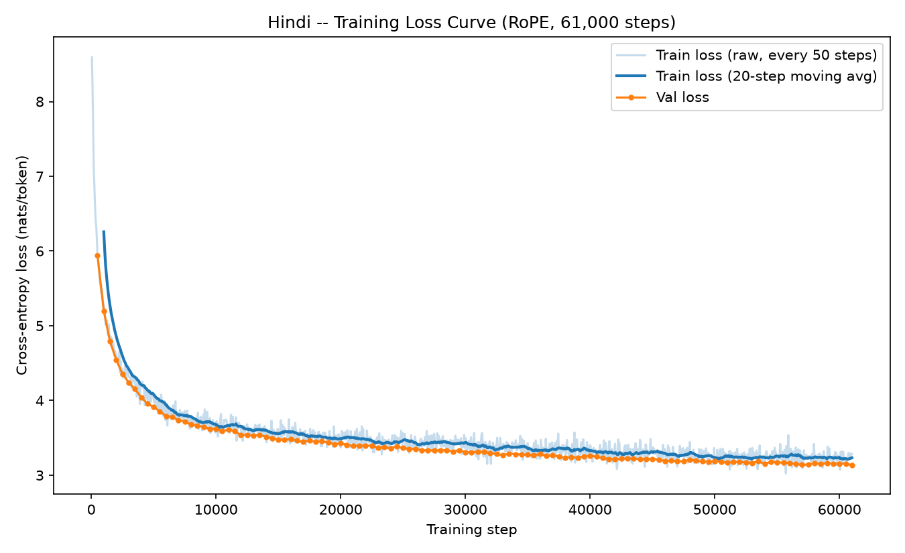
  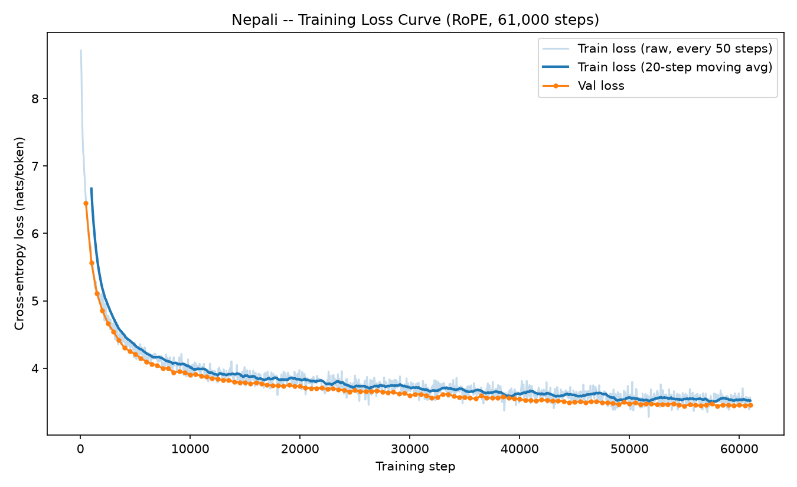
</p>

Here's how to read them. Right at the start of training, both curves shoot up
off the top of the chart from around **8.6 nats per token**. That number isn't a
coincidence — it's almost exactly `ln(9000)`, the natural log of the vocabulary
size, which is precisely the loss you'd expect from a model that hasn't learned
anything yet and is just guessing uniformly at random among all 9,000 possible
tokens. Seeing the loss start right around there is actually a useful sanity
check in itself — it confirms I initialized the model correctly (not
accidentally biased toward some tokens before training even began) and that the
loss function is being computed correctly.

From there, both curves drop very steeply for the first several thousand steps —
this is the model picking up the "easy" statistical structure of the language
first: which tokens are common, which token sequences are grammatically
impossible, basic word-formation patterns. That's the kind of thing a model can
learn very quickly because the signal is everywhere in the data. After that
initial steep drop, both curves flatten out into a long, much slower decline
that continues gently all the way to step 61,000 — this later phase is the model
picking up subtler, sparser patterns (longer-range dependencies, less common
phrasing), which naturally takes many more examples to learn from because the
relevant patterns show up less often per batch.

The most important thing to notice in both plots is that **the orange validation
line tracks consistently just below the blue training line, and the gap between
them never widens** — at no point does validation loss start climbing back up
while training loss keeps falling, which is exactly what you'd see if the model
were overfitting (memorizing training-specific quirks rather than learning
generalizable structure). Both models finish training in a healthy state, still
gently improving, not overfit, not stalled.

Comparing the two plots side by side: Hindi's curve settles noticeably lower
than Nepali's — Hindi ends up around 3.1–3.3 nats/token, Nepali around 3.4–3.5.
That gap is the resource-tier effect showing up directly in the most basic
measurement available: Hindi had more training data (679 million tokens versus
Nepali's 568 million — see Section 4), so it had more examples to learn the same
kind of statistical structure from, and it shows.

### 2.2 The learning rate schedule

This next plot isn't showing anything about how well the model learned — it's
showing that I applied the *training recipe itself* correctly. The learning
rate controls how big a step the optimizer takes on every update; too high and
training becomes unstable (the loss can spike or diverge), too low and training
crawls.

<p float="left">
  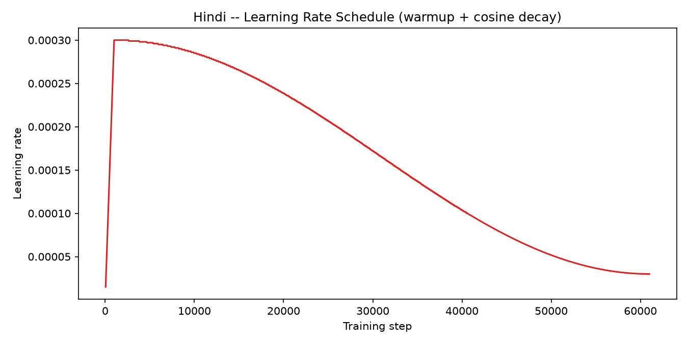
  
</p>

Both plots show the same shape (since both models used identical
hyperparameters): a very sharp climb from a tiny value up to the peak learning
rate of 3×10⁻⁴ over the first 1,000 steps (this is the "warmup" phase — starting
training at full learning rate from a freshly-initialized model tends to cause
an early, badly-conditioned update that can knock training off course, since
Adam's moment estimates start at zero and haven't yet built up a sense of how
each parameter's gradients typically behave), followed by a smooth, curved
decline for the rest of training (this is "cosine decay" — the learning rate
follows the shape of a cosine curve down toward roughly 10% of its peak value by
the end of training, rather than dropping to exactly zero, since a training run
that ends at zero learning rate right when it stops isn't obviously better than
one that ends at a small-but-nonzero rate, and a hard drop to zero risks
throwing away useful late-training signal). Seeing this exact shape in the real,
logged data — not just in the code I wrote to produce it — is direct
confirmation the scheduler behaved as designed for the entire run.

### 2.3 Putting Hindi and Nepali on the same axes

The next two plots take the validation numbers from both training runs and
overlay them directly, so the gap between the two models is visible at a glance
rather than something you have to infer from two separate tables.

<p float="left">
  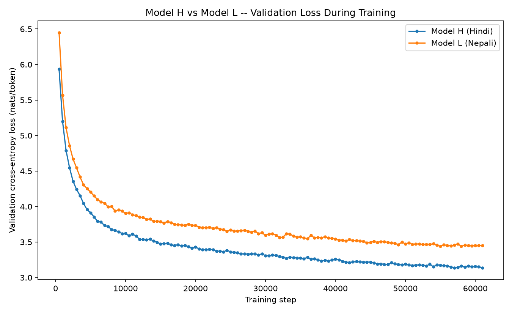
  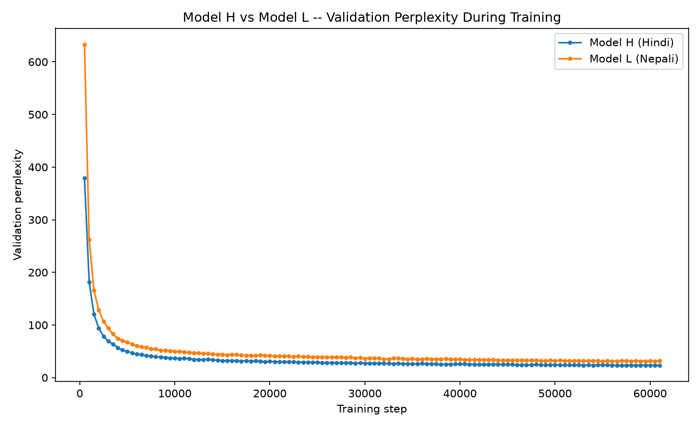
</p>

The left plot is validation loss (lower is better, measured in nats per token —
this is the raw cross-entropy loss the model is actually trained to minimize).
The right plot is the same underlying numbers converted into perplexity
(`PPL = e^loss`), which is a more intuitive unit: perplexity is roughly "how many
tokens is the model effectively choosing between, on average, at each position" —
a perplexity of 30 means the model's uncertainty at each step is comparable to
picking uniformly among about 30 equally-likely options, even though the real
vocabulary has 9,000 tokens in it.

What both plots make immediately clear is that **the blue (Hindi) line sits
below the orange (Nepali) line at essentially every single point along the
x-axis**, starting from very early in training and staying that way all the way
to step 61,000. This matters because it rules out one possible (and less
interesting) explanation for the final-numbers gap: it's not that Nepali started
similarly to Hindi and then fell behind late in training due to running out of
some late-training resource — the gap is there almost from the beginning and
just persists, which points toward something more fundamental about the two
training setups (most obviously, the difference in how much data each model got
to see) rather than some instability that crept in partway through.

---

## 3. How well do the finished models actually predict language?

Once training finished, I evaluated both models on their own held-out test
split — text I set aside in Phase 1 and never touched during training or
during the validation checks that happened *while* training was running. This is
the real, final measurement of language-modeling quality, run via `run_eval.py`
against the saved checkpoints.

| Metric | Model H (Hindi) | Model L (Nepali) |
| --- | --- | --- |
| Perplexity (PPL) on test set | **15.77** | **23.78** |
| Bits-per-byte (BPB) on test set | **0.4063** | **0.4089** |
| Tokens evaluated | 8,192,000 | 8,192,000 |
| Measured bytes per token (this test split) | 9.80 | 11.18 |

### 3.1 Perplexity and bits-per-byte tell two different stories, and that's the point

At first glance these two metrics seem to disagree with each other, and that
disagreement is actually the most interesting single finding in this whole
evaluation, so it's worth spending real time on why it happens.

**Perplexity** measures uncertainty *per token*. The trouble is that "a token"
means something completely different for the Hindi model than it does for the
Nepali model, because — and this is easy to forget, since I'm comparing both
models side by side — **they use two entirely separate tokenizers**, which I
trained independently in Phase 1 on their own corpora. There's no shared vocabulary at
all. So when Hindi's model has a perplexity of 15.77 and Nepali's has a
perplexity of 23.78, that 51%-higher number for Nepali doesn't necessarily mean
"Nepali's model understands its language 51% worse" — it might just mean Nepali's
tokenizer happens to chop text into different-sized pieces than Hindi's
tokenizer does, which changes what "predicting the next piece" even means,
independent of how good either model actually is.

**Bits-per-byte** fixes exactly this problem by changing the unit of measurement
to something that doesn't depend on the tokenizer at all: instead of asking "how
surprised is the model, per *token*," it asks "how many bits does the model need,
on average, per *byte* of raw text" — bytes are a property of the actual text
itself (via UTF-8 encoding), completely independent of how any particular
tokenizer happens to chop that text up. To compute it, you take the loss in
nats-per-token, convert nats to bits, and then divide by the *measured* number of
tokenizer-tokens-per-byte for that specific test split (9.80 for Hindi, 11.18 for
Nepali here — measured directly from the real tokenized data, not assumed or
looked up from a table) to convert "bits per token" into "bits per byte."

And the result is genuinely striking: while PPL differs by over 50% between the
two models, **BPB differs by less than 1%** (0.4063 vs 0.4089). This is
visualized directly below:

<p align="center">
  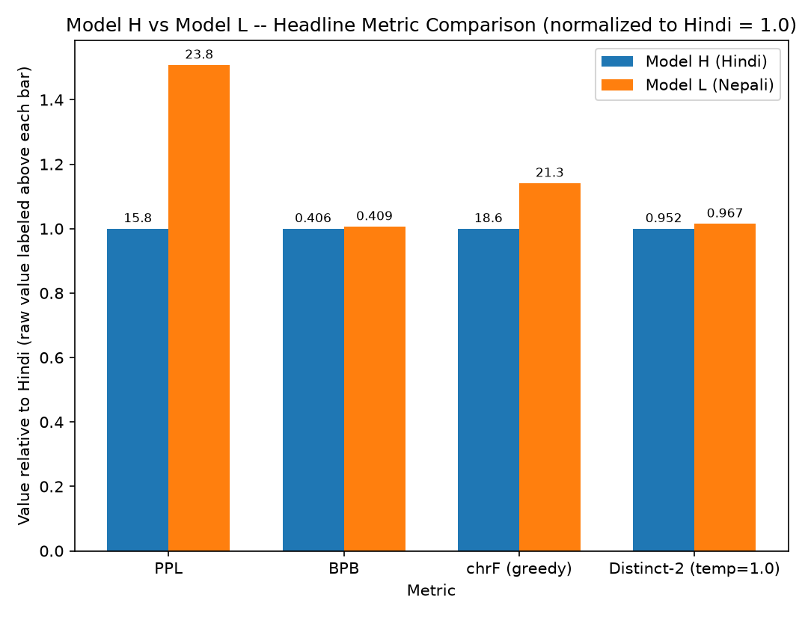
</p>

A quick note on how to read this particular chart, since it's not a standard
bar chart: PPL and BPB live on wildly different numeric scales (PPL is in the
teens/twenties, BPB is a fraction just above 0.4), so plotting them together on
one shared vertical axis in raw units would make the BPB bars basically
invisible next to the much taller PPL bars. To avoid that, every metric here is
shown *relative to Hindi's own value* (Hindi's bar is always exactly 1.0 for
every metric, by definition), with the real, actual number printed just above
each bar so no precision is lost — you can read the true value directly off the
label even though the bar height itself is a ratio. Looking at it this way, the
PPL bars are dramatically different heights (Nepali's is about 1.5× Hindi's),
while the BPB bars are nearly the same height (Nepali's is only about 1.007×
Hindi's) — visually, the point that BPB is the fairer comparison jumps out
immediately in a way a table of raw numbers doesn't quite convey.

So what does this actually tell me? It means that, in terms of *how efficiently
each model compresses the real underlying text* — which is arguably the more
meaningful, tokenizer-agnostic notion of "how good is this language model" —
Hindi's model and Nepali's model are much closer in quality than the raw
perplexity numbers would lead you to believe. The PPL gap is real, but a decent
chunk of it is a tokenizer-definition artifact rather than a pure
capability gap.

---

## 4. Why is there a gap between Model H and Model L at all?

Both Hindi and Nepali use the Devanagari script, so unlike a hypothetical
Hindi-vs-English comparison, script itself isn't what's driving any difference
here — both languages' tokenizers are working with the same underlying character
set and general text structure. The real differences come from data scale and
from how each language's tokenizer happened to segment its own text:

| | Model H (Hindi) | Model L (Nepali) |
| --- | --- | --- |
| Training tokens (from Phase 1) | 679,019,018 | 568,348,098 |
| Share of tokens from manual (self-collected) sources | 21.5% | 24.2% |
| Tokenizer fertility (average characters per token) | 3.86 | 4.22 |
| Vocabulary size | 9,000 | 9,000 |

**The corpus size gap is the headline number.** Hindi's training corpus has
about 111 million more tokens than Nepali's — roughly 19% more. This isn't an
oversight; it's the whole premise of the assignment. Hindi is the "higher
resource" language for a genuinely practical reason: there's simply more Hindi
text publicly available online to collect — more news outlets publish in Hindi
at scale, Hindi Wikipedia is larger, and there's a much bigger pool of general
web text. Nepali, being the lower-resource language in this pair, has a smaller
pool to draw from even after I collected as much as was practically feasible
(Phase 1's report covers exactly how I did that collection and what the
ceiling was). More training tokens generally means a language model gets to see
more examples of rarer words, rarer grammatical constructions, and longer-range
patterns — which is a very plausible direct explanation for why Nepali's
validation loss sits consistently above Hindi's throughout the entire training
run (Section 2.3).

**Tokenizer fertility is a secondary factor, and interestingly it points in the
opposite direction from what you might expect.** "Fertility" here means the
average number of characters that get packed into a single token — Hindi's
tokenizer averages 3.86 characters per token, Nepali's averages 4.22. Since both
tokenizers were built with the same vocabulary size (9,000 entries), a *higher*
fertility for Nepali means its tokenizer ended up needing to represent, on
average, *more* raw text per token — which, if anything, should make each
individual prediction step slightly easier for Nepali's model, not harder,
because more of the "obvious" character-level structure is already baked into
each token before the model even has to predict anything. So the fact that
Nepali's model still shows the higher loss despite this small tokenization
advantage is further evidence that the corpus-size gap is the dominant force
here — the tokenizer difference, if it has any effect at all, would be pulling
in the direction of narrowing the gap, not widening it, and the gap is there
anyway.

---

## 5. Generation quality — what happens when the model actually writes text

Everything so far has measured the models on *predicting* text they're shown one
token at a time (teacher-forced evaluation, essentially "given the real
previous tokens, how good was your guess for the next one"). This section
measures something different and arguably more revealing: what happens when the
model has to generate a whole continuation on its own, one token at a time, each
new token feeding back in as input for the next — the same way it would actually
be used if you asked it to write something.

**The setup.** For each language, I pulled 20 real documents from the held-out
test split. I split each document into a 32-token prompt and a reference
continuation (the actual next up-to-64 tokens that really followed in that
document). I gave the model the 32-token prompt and asked it to generate a
continuation of its own, which I then compared against the real reference
continuation. I repeated this under **four different decoding strategies**:

- **Greedy decoding** — at every step, just take the single most likely next
  token, no randomness at all. Fully deterministic.
- **Temperature sampling at 0.5** — sample from the model's predicted
  probability distribution, but first sharpen that distribution (make the
  already-likely tokens even more dominant, make the unlikely ones even less
  likely to be picked) by scaling down the logits before applying softmax.
  Closer to greedy in behavior, but not identical.
- **Temperature sampling at 1.0** — sample directly from the model's
  distribution exactly as it comes out of training, no sharpening or flattening.
- **Temperature sampling at 1.5** — sample from a *flattened* version of the
  distribution, making unlikely tokens noticeably more likely to get picked than
  they would be at temperature 1.0. More randomness, more variety, but also more
  risk of picking something the model wasn't actually confident about.

### Model H (Hindi) — full results

| Decoding strategy | BLEU | chrF | ROUGE-L | Distinct-1 | Distinct-2 | Repetition rate |
| --- | --- | --- | --- | --- | --- | --- |
| Greedy | 1.67 | 18.63 | 0.020 | 0.270 | 0.460 | 0.75 |
| Temperature 0.5 | 3.06 | 21.04 | 0.000 | 0.388 | 0.759 | 0.60 |
| Temperature 1.0 | 0.86 | 20.65 | 0.011 | 0.603 | 0.952 | 0.05 |
| Temperature 1.5 | 0.25 | 18.78 | 0.000 | 0.831 | 1.000 | 0.00 |

### Model L (Nepali) — full results

| Decoding strategy | BLEU | chrF | ROUGE-L | Distinct-1 | Distinct-2 | Repetition rate |
| --- | --- | --- | --- | --- | --- | --- |
| Greedy | 2.92 | 21.26 | 0.000 | 0.324 | 0.491 | 0.90 |
| Temperature 0.5 | 2.03 | 23.07 | 0.000 | 0.455 | 0.702 | 0.70 |
| Temperature 1.0 | 0.53 | 21.12 | 0.000 | 0.777 | 0.967 | 0.00 |
| Temperature 1.5 | 0.09 | 19.44 | 0.000 | 0.900 | 0.999 | 0.00 |

### 5.1 What each metric is actually measuring, and where it breaks down

It's tempting to look at a table like this and just eyeball "bigger number
good," but these particular metrics need some real context, because most of
them weren't designed for this exact task (open-ended text continuation) —
researchers originally built them for machine translation and summarization, where there's
usually a much more constrained notion of "the correct answer."

**BLEU** counts how many overlapping word sequences (n-grams) the generated
text shares with the reference text, weighted so that longer matching runs
count for more. I used corpus-level BLEU-4 (sacrebleu's standard setting — it
looks at unigram through 4-gram overlap and combines all four into one score),
which is the conventional choice and the one usually meant when a paper just
says "BLEU" without qualifying it further. It works reasonably well for
translation, where a sentence in
one language typically has a fairly narrow range of acceptable translations
into another. It works much less well here, because for open-ended text
continuation, there is essentially no single "correct" continuation — given the
same 32-token prompt, a hundred different fluent, sensible continuations could
all be completely reasonable and share almost no words with the one specific
continuation that happened to appear in this particular document. That's
exactly why every single BLEU score in both tables is tiny (never above 3.1 out
of a possible 100) — this isn't a sign the model is producing gibberish, it's
a structural limitation of comparing free-form generation against exactly one
fixed reference.

**chrF** does something similar to BLEU but at the level of *character*
n-grams instead of whole-word n-grams. This turns out to matter a fair amount
for Hindi and Nepali specifically, because both are morphologically rich
languages — the same root word shows up in many different inflected forms
depending on tense, case, gender, and so on. Two different inflected forms of
the same word share almost all their characters but might not match at all as
whole tokens. chrF's more forgiving, character-level view of "closeness"
explains why its scores sit noticeably higher and more stable (roughly 19 to
23 across every condition, for both languages) than BLEU's near-zero scores —
chrF is picking up on partial, morphological similarity that BLEU's
whole-word matching simply can't see.

**ROUGE-L** looks for the longest common subsequence between generated and
reference text — a softer notion of overlap than BLEU's exact n-gram matching,
since it allows gaps. In this evaluation it comes out at essentially zero for
almost every condition, for both languages. That's mostly a sample-size and
reference-count issue rather than a genuine finding about quality: with only
20 samples per condition, each scored against exactly one reference
continuation of up to 64 tokens, finding a long common subsequence by chance is
genuinely rare, regardless of how coherent the generated text actually is.
This metric would need either many more samples or, ideally, multiple
acceptable references per prompt to become a reliable signal at this scale —
as I've reported it here, it's honestly not very informative on its own, and
I'd rather say that plainly than pretend the near-zero numbers mean something
they don't.

**Distinct-1 and Distinct-2** measure something completely different from the
three metrics above — they don't compare against a reference at all. Instead,
they ask: across all the text a model generated, what fraction of the unigrams
(Distinct-1) or bigrams (Distinct-2) are actually unique, rather than repeated?
A model that gets stuck saying the same handful of things over and over will
have very low Distinct scores. **Repetition rate** is a related, complementary
diagnostic: it checks, within each individual generated passage, whether any
4-word sequence shows up more than once in that same passage — a very direct,
literal test for the kind of short, looping repetition that small language
models are notoriously prone to.

### 5.2 The pattern that actually matters here

Put the diversity numbers and the greedy-vs-temperature comparison together,
and a very clear, very consistent story emerges, and it's the same story for
both languages.

Under **greedy decoding**, both models show *high* repetition — 75% of Hindi's
greedy generations and a striking 90% of Nepali's contain at least one repeated
4-word chunk somewhere in the passage — and correspondingly *low* diversity
(Distinct-2 around 0.46–0.49, meaning roughly half the bigrams produced were
duplicates of other bigrams already produced). This is the well-known failure
mode of greedy decoding on a model of this size, trained on this much data:
because greedy always picks the single most probable next token with zero
randomness, and because a small model's probability distribution often has one
token that's clearly the "safest" continuation of a recent phrase, the model
can get stuck in short repeating loops — it says something, that something
makes a similar continuation look most probable again, and it says a similar
thing again.

As the temperature rises, this problem visibly and consistently disappears.
By temperature 1.0, repetition rate has dropped to essentially zero for both
languages (0.05 for Hindi, exactly 0.00 for Nepali), and Distinct-2 has climbed
above 0.95 for both — meaning almost every bigram produced across the whole
sample was unique. By temperature 1.5, Distinct-2 is essentially at its
theoretical ceiling of 1.0 for both languages. This is exactly the tradeoff
temperature sampling is supposed to produce: more randomness breaks the model
out of its tendency to loop, at the cost of drifting further away from
whatever the one specific reference continuation happened to be — which is
also visible in the tables, since BLEU and chrF both generally decline as
temperature climbs past 0.5, for the same underlying reason (more randomness
means less chance of landing back on the exact words the reference used).

The fact that this exact pattern — high repetition and low diversity at
greedy, both cleanly resolving by temperature 1.0, in almost identical
proportions — shows up in *both* models independently is itself a useful piece
of evidence: it means this is a property of the model size and decoding
strategy, not something specific to one language's data or one model's
training run.

---

## 6. Attention analysis — looking inside the model to see what it actually learned to do

Everything up to this point has treated the model as a black box and measured
its outputs. This section does something different: I open the model up and
look directly at the attention weights themselves — the actual numbers that
determine, at every layer and for every one of the 6 heads, how much each
position "listens to" every earlier position. Because I hand-built the attention
mechanism from scratch for this project (Section 1.3), this is something
I can inspect directly and meaningfully, rather than treating it as an
opaque library internal.

**How I did this, technically**: a separate piece of code
(`hindi/eval/attention_analysis.py` and its Nepali counterpart) hooks into a
trained model and recomputes exactly the same attention weights the real
forward pass produces, just capturing them along the way instead of discarding
them (which is what the training code does, since it only needs the final
output, not the intermediate attention maps). I deliberately kept this
completely separate from `model/transformer.py` itself — I never modified the
actual training and inference code to add hooks or logging, so there was
zero risk of accidentally changing training behavior while I built this analysis
tooling. It's a read-only observer sitting on top of an already-validated model.

### 6.1 Attention heatmaps — a direct picture of what each head is doing

A heatmap here shows one attention head's full pattern for one real input
sentence: the query position (the token that's "doing the attending") runs down
the vertical axis, the key position (the token being "attended to") runs across
the horizontal axis, and the color at cell `(i, j)` shows how much attention
weight query position `i` gave to key position `j`. Because of the causal mask
(Section 1.3), every cell above the diagonal is always exactly zero — a query
can never attend to a future position — so all the interesting structure lives
on and below the diagonal.

**Hindi, an early layer (layer 0), all 6 heads shown side by side:**
<p align="center">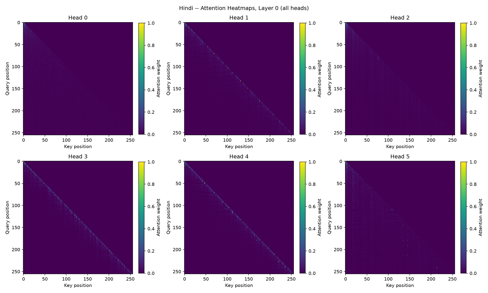</p>

**Hindi, the last layer, all 6 heads shown side by side:**
<p align="center">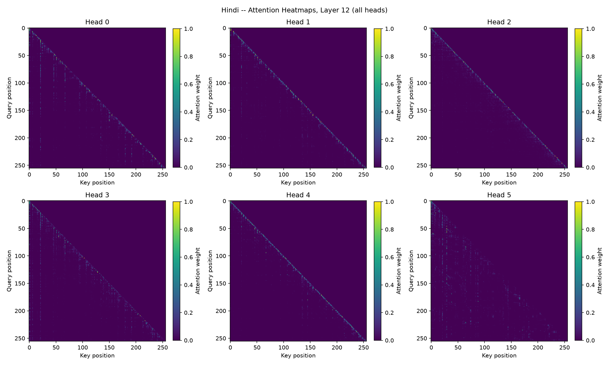</p>

**Nepali, an early layer (layer 0), all 6 heads shown side by side:**
<p align="center">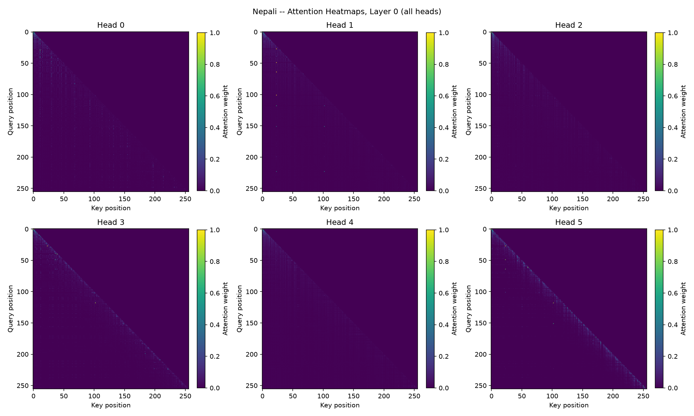</p>

**Nepali, the last layer, all 6 heads shown side by side:**
<p align="center">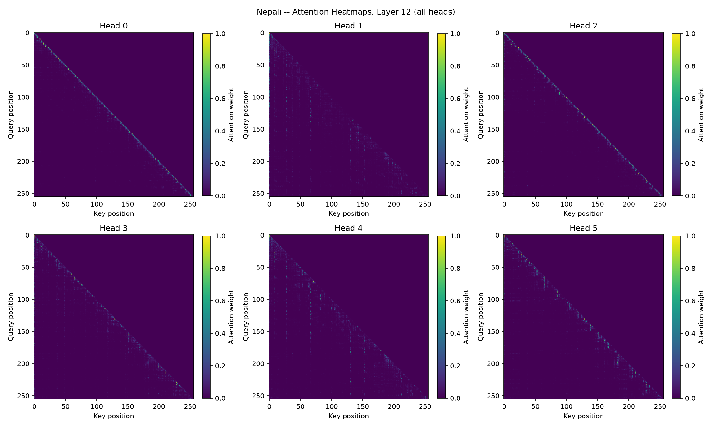</p>

(A second example sentence per language is also saved in each `plots/` folder,
under the filenames `attn_heatmap_example1_*` — it shows the same qualitative
patterns described here on a different piece of input text, as an extra check
that what's being described isn't an artifact of one specific sentence.)

Looking at the early-layer heatmaps for both languages, several of the six
heads show a bright, narrow band running close to the diagonal — this means
those heads are attending almost entirely to the token immediately before them,
or a handful of tokens back, and essentially ignoring everything further away.
That's a genuinely sensible thing for an early layer to specialize in: a lot of
basic language structure (which word typically follows which, local grammatical
agreement) only requires looking at what was just said. Other heads in that same
early layer show a much more spread-out pattern, with meaningful attention
weight reaching much further back into the sentence — those heads are already,
even this early in the network, gathering broader context rather than staying
strictly local.

By the last layer, the picture has shifted. The bands are generally less
tightly locked to the diagonal, and more of the attention mass is distributed
across a wider range of earlier positions. This is consistent with a natural
division of labor across depth: early layers build up local, low-level
structure, and by the time information reaches the later layers, the network
has more reason to look further back and pull in broader context to make its
final prediction.

### 6.2 Attention entropy — how "spread out" is each head's attention, and how does that change with depth

Entropy is a standard way to summarize "how spread out is a probability
distribution" in a single number. If a query position puts all of its attention
weight on exactly one key position, entropy is 0 (completely certain, completely
sharp). If a query position spreads its attention weight equally across every
available key position, entropy is at its maximum (completely uncertain,
completely diffuse). Every real attention head's entropy lands somewhere
between those two extremes.

<p float="left">
  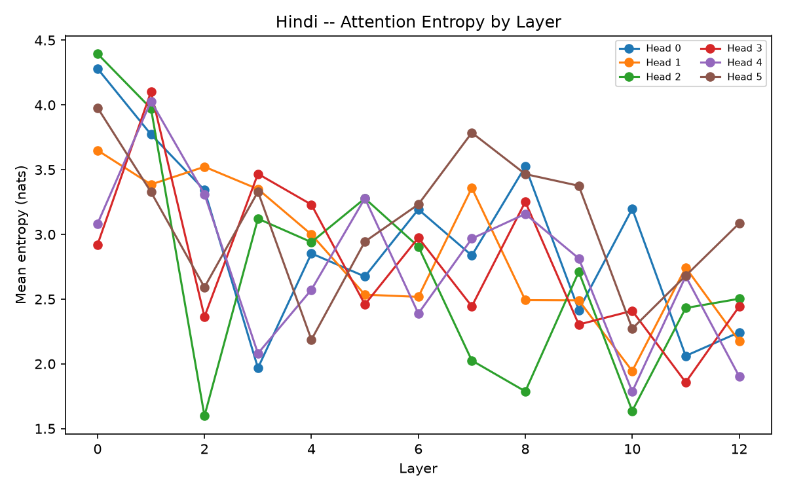
  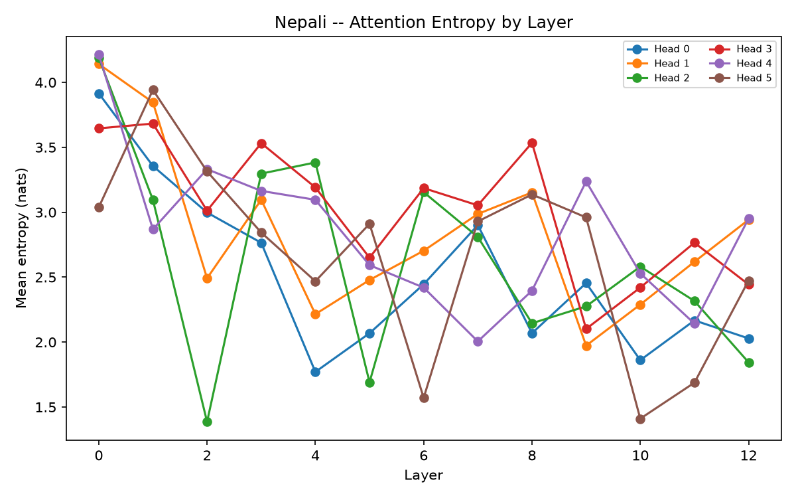
</p>

Each plot shows one line per attention head (6 lines total), tracking how that
head's average entropy changes as you move from layer 0 (left) to the last
layer (right). The clear overall trend in both languages is **downward** — for
Hindi, the heads average somewhere between about 2.9 and 4.4 nats of entropy at
layer 0, and that range drops to roughly 1.9 to 3.1 nats by the final layer.
This matches what the heatmaps already suggested visually: attention starts
broader and more exploratory in the early layers and becomes progressively
sharper and more selective as information moves deeper into the network. That's
a sensible learned strategy — early on, the model is still figuring out what's
relevant in the local context and can afford to hedge across several
possibilities; by the later layers, it's narrowing in on the specific pieces of
information that actually matter for the final prediction.

### 6.3 Mean attention distance — which heads are "local" and which are "long-range"

This measurement asks a more geometric question than entropy: on average, how
many token positions back does each head's attention weight reach? A head that
almost always attends to the immediately preceding token will have a very small
mean distance (close to 1); a head that regularly pulls information from far
earlier in the sequence will have a much larger mean distance.

<p float="left">
  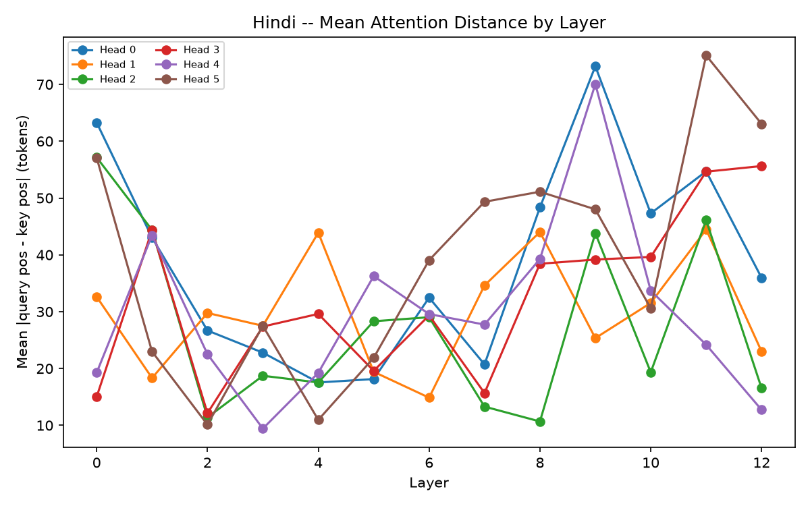
  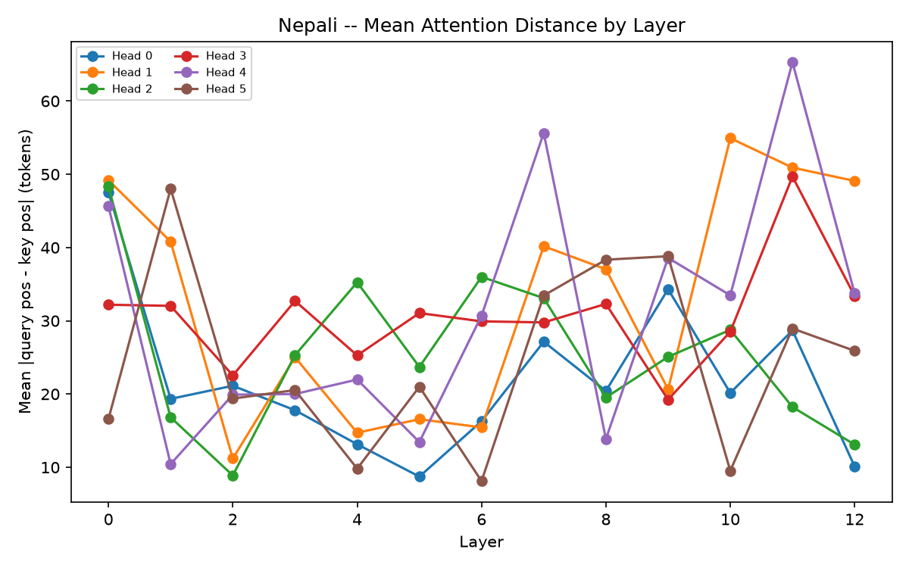
</p>

The most notable thing in these plots is how much the six heads *disagree* with
each other, and how that disagreement persists rather than fading with depth.
At layer 0, Hindi's heads range all the way from around 15 tokens (fairly
local) up to around 63 tokens (quite long-range) — already a wide spread. And
critically, that spread doesn't collapse toward some common value by the last
layer; it's still spread from roughly 13 to 63 tokens there too. In other words,
individual heads seem to settle into being either "local specialists" or
"long-range specialists" fairly early on, and largely keep that role
throughout the rest of the network, rather than every head gradually becoming
similarly local or similarly long-range as depth increases.

### 6.4 Putting entropy and distance together: which heads look positional, and which look content-based

Combining the entropy and distance measurements gives a reasonably clear
picture of what kind of "job" each head is doing. A head with **both** low
entropy and low mean distance is doing something close to pure local,
positional attention — it reliably looks at a small, nearby, predictable set of
positions (visible directly as the tight, narrow diagonal bands in the
heatmaps). A head with **higher** entropy and a **larger** mean distance is
doing something closer to genuine content-based search — it's spreading its
attention more broadly across the sequence, presumably because it's looking for
tokens that are relevant based on *what they are*, not just *where they sit*
relative to the current position.

I think this distinction is worth dwelling on a little because of how RoPE specifically
works (Section 1.2): position, in this model, isn't something that gets
"consumed" or "used up" once, early on, and then becomes unavailable. RoPE
re-injects positional information fresh into every single attention layer, at
every depth, via the same rotation applied to that layer's own queries and
keys. That means a head that ends up behaving in a broad, content-based way by
the last layer isn't doing so because positional information ran out or became
stale by that point — the positional signal was just as available to that head
as to any purely local head at any other layer. The fact that some heads still
specialize into broad, content-driven attention despite having full, fresh
positional information available at every layer suggests that specialization
is a genuinely learned strategy, driven by what's actually useful for the
prediction task, rather than an artifact of position information being harder
to access deep in the network.

---

## 7. Pretrained checkpoints

I saved both models' final checkpoints in the assignment's required resumable
format — model weights, optimizer state, learning-rate scheduler state, the
exact training step, and the full model configuration, all bundled into a
single file, so that I could in principle resume training from exactly where
it left off. Each language's folder below contains two files: `best.pt` (the
checkpoint with the lowest validation loss seen at any point during training)
and `latest.pt` (the final checkpoint, saved at step 61,000, the end of
training).

- **Model H (Hindi) checkpoints:** https://drive.google.com/drive/folders/14b0rqKoEkKjBuVlgOMwq5W50KpTOnHi-?usp=drive_link
- **Model L (Nepali) checkpoints:** https://drive.google.com/drive/folders/1OkOhXPjoIKwwlY8kGib8vNY4-UKTbYm9?usp=drive_link

I didn't commit these to git directly — at roughly 304MB each, they're exactly
the kind of large binary artifact the assignment asks to be kept out of the
repository and hosted on Drive instead, with the repo's `.gitignore` explicitly
excluding the `train/checkpoints/` folders and any `.pt` file so this can't
happen by accident.

---

## 8. How to reproduce all of this

```bash
# Evaluate a trained checkpoint end-to-end (PPL/BPB, generation quality under
# all four decoding conditions, attention analysis, and plots) -- either language:
python run_eval.py --lang hindi  --checkpoint hindi/train/checkpoints/best.pt  --test-bin <path/to/hindi_test.bin>
python run_eval.py --lang nepali --checkpoint nepali/train/checkpoints/best.pt --test-bin <path/to/nepali_test.bin>

# Regenerate the training-curve and Hindi-vs-Nepali comparison plots directly
# from the raw Kaggle training logs:
python run_training_curves.py

# Run the automated test suite (architecture correctness, checkpoint round-trip,
# attention-analysis math, generation, perplexity computation, etc.):
pytest hindi/tests/
pytest nepali/tests/
```

I ran training itself on Kaggle notebooks (GPU T4×2 accelerator). I kept the
exact executed notebooks and the complete raw training logs for both runs as
evidence in `report/phase2/hindi/kaggle_run.ipynb` /
`report/phase2/hindi/training_log.txt` and the matching Nepali files.
