# Phase 3 Report — Reasoning Finetuning, Attention Analysis, and Final Comparison

This report covers the last phase of the project: taking my two pretrained models
from Phase 2 (Model H for Hindi, Model L for Nepali) and finetuning each one on a
reasoning task in its own language, checking whether finetuning actually taught the
models anything, looking at how their attention patterns changed, and finally
pulling together everything from all three phases into one comparison of the two
languages.

As before, Model H and Model L never touch each other anywhere in this phase either.
Each one gets its own synthetic dataset, its own finetuning run starting from its
own Phase 2 checkpoint, its own tokenizer (frozen, unchanged from Phase 1), and its
own separate set of results. The only thing shared between them is the *code* that
generates the dataset and runs the finetuning loop — not the data, not the weights,
not the vocabulary.

---

## 1. The reasoning task I built

The assignment wants a synthetic dataset of comparative/basic reasoning questions —
things like "A is taller than B, B is taller than C, so who is tallest" — written in
each model's own language, generated programmatically rather than downloaded from
somewhere, with known ground truth and with train/test splits that don't leak into
each other.

### 1.1 What a question actually looks like

I built three kinds of questions, all following the same basic shape: state some
facts about a few people (a numeric value for some attribute — height, age, price,
weight, or distance), then ask a question that can only be answered by comparing
those numbers.

**Pairwise** — two people, one attribute, straightforward comparison:

> राम की उम्र 20 साल है। श्याम की उम्र 30 साल है। राम और श्याम में से कौन बड़ा है?
> (Ram is 20 years old. Shyam is 30 years old. Who is older, Ram or Shyam?)

**Ranking** — three people, asks for the largest or smallest of the three:

> सीता की वज़न 114 किलोग्राम है। कमल की वज़न 79 किलोग्राम है। प्रकाश की वज़न 88
> किलोग्राम है। सीता, कमल और प्रकाश में से किसकी वज़न सबसे ज़्यादा है?
> (Sita weighs 114 kg. Kamal weighs 79 kg. Prakash weighs 88 kg. Who weighs the
> most among Sita, Kamal, and Prakash?)

**Transitive (multi-hop)** — three people are described in decreasing order of the
attribute, but only the two *adjacent* relationships are ever stated as separate
facts. The question then asks about the two people whose relationship was never
directly stated, so the only way to answer correctly is to chain the two given
facts together:

> करण की ऊँचाई 188 सेंटीमीटर है। कमल की ऊँचाई 187 सेंटीमीटर है। प्रकाश की ऊँचाई
> 152 सेंटीमीटर है। करण और प्रकाश में से कौन बड़ा है?
> (Karan is 188 cm. Kamal is 187 cm. Prakash is 152 cm. Who is taller, Karan or
> Prakash?)

Here the model is never told "Karan is taller than Prakash" outright — it has to
notice that Karan > Kamal and Kamal > Prakash are both given, and put those two
facts together to get Karan > Prakash. That's exactly the "short multi-hop
comparison" the assignment example describes.

I picked five attributes per language — height, age, price, weight, and distance —
each with its own natural unit word (सेंटीमीटर/सेन्टिमिटर for height, रुपये/रुपैयाँ
for price, and so on) and its own sensible numeric range, so a "height" is never
sampled from the same range as a "price". The person names are drawn from a pool of
about 30 common Hindi/Nepali names for each language, not the same names — I did
not translate one language's name list into the other, I wrote each one separately
so the two languages' datasets don't share a single entity between them.

Every example's answer is computed from the actual numbers I sampled for that
example, not copied out of the template — so scoring a generated answer against the
`answer` field is checking it against a genuinely computed fact, not a memorized
string.

### 1.2 How I made sure the test set isn't just a memorization check

This part matters a lot, because if train and test share the same people's names,
a model could get a high score just by memorizing "Ram is always older" without
doing any actual comparison. I closed that off in two separate ways at once:

**Held-out entity names.** Before generating anything, I split each language's name
pool into two disjoint groups — about three-quarters of the names go into a
"training" pool, and the remaining quarter go into a "held-out" pool that only
val and test are allowed to draw from. Every training example is built only from
training names; every val/test example is built only from held-out names. A name
that shows up in test has never been seen by the model during finetuning, in any
sentence, in any role.

**Held-out attribute.** On top of that, I held back one entire attribute — distance
— from training entirely. The model finetunes on height/age/price/weight questions
only; distance-based questions only appear in val and test. That means test isn't
just testing "new names, same four attributes I've seen a thousand times" — some of
it is testing a comparison *type* the model has literally never been finetuned on.

I wrote automated tests (`tests/test_reasoning_gen.py`) that check both of these
properties directly: that no prompt in train appears in test, that no entity name
used in train ever appears in a test prompt, and that the held-out attribute is
completely absent from train while present in test. All of these pass, so this
isn't just a claim — it's checked mechanically every time the dataset gets
regenerated.

### 1.3 Dataset sizes

| Split | Hindi examples | Nepali examples |
|---|---|---|
| Train | 6,000 | 6,000 |
| Validation | 600 | 600 |
| Test | 800 | 800 |

And the mix of question types within each split (Hindi numbers shown, Nepali is
almost identical since both use the same generation logic just with different
vocabulary):

| Kind | Train | Validation | Test |
|---|---|---|---|
| Pairwise | 2,644 | 194 | 231 |
| Ranking | 2,115 | 189 | 237 |
| Transitive | 1,241 | 217 | 332 |

I deliberately gave transitive questions a bigger share of val/test than of train
(roughly 20% of train vs. 40% of val/test) — multi-hop chaining is the harder skill
the assignment specifically calls out, so I wanted the evaluation to lean on it more
than the training data does.

The generation code lives in `collection/common/reasoning_gen.py` (the actual
question-building logic, shared between both languages so I only had to get the
train/test-split logic right once) plus `hindi/reasoning/generate.py` and
`nepali/reasoning/generate.py` (each language's own name list, attribute list, and
sentence phrasing — nothing shared here). Running either script regenerates that
language's dataset from scratch and writes it to `<lang>/reasoning/splits/`.

---

## 2. Finetuning

### 2.1 Setup

For each language I started from that language's own Phase 2 checkpoint (the
`best.pt` file — the one with the lowest pretraining validation loss, not
necessarily the last one saved) and finetuned only on that language's own reasoning
data. The tokenizer stayed completely frozen — I never retrained it or changed the
vocabulary, exactly as the assignment's finetuning protocol asks.

Each training example is turned into a single sequence: the facts and the question,
followed by a short separator word (उत्तर: in Hindi, जवाफ: in Nepali — both just
mean "answer:"), followed by the answer. I didn't add a new special token to the
vocabulary for this separator, since the tokenizer is supposed to stay frozen — I
just used a plain word the model had already seen plenty of times during Phase 1
pretraining, so it's not some foreign symbol to it.

The important part is where the loss gets computed. If I just ran ordinary
next-token prediction over the whole sequence, the model would also be getting
gradient signal for predicting the *facts themselves* back — but those facts are
given information, not something the model should be "guessing". So I masked the
loss to apply only to the answer tokens (and the end-of-sequence token right after
them). Everything before that — the facts, the question, the separator word —
contributes zero loss. This way every bit of gradient the model gets during
finetuning is actually about answering the question, not about memorizing how to
restate the input.

Hyperparameters (same for both languages, kept in `<lang>/configs/finetune.yaml`):

| Hyperparameter | Value |
|---|---|
| Learning rate | 5e-5 |
| Weight decay | 0.01 |
| Warmup steps | 50 |
| Epochs | 8 |
| Batch size | 16 |
| Optimizer | AdamW |
| LR schedule | linear warmup, then cosine decay to 10% of peak |

I used a noticeably lower learning rate here than in pretraining (5e-5 vs.
pretraining's 3e-4) because this is a short adaptation of an already-trained model
on a comparatively tiny dataset, not training from scratch — a large learning rate
on only 6,000 examples would risk wrecking what the model already knows about the
language just to memorize this narrow task.

Checkpoints are saved in exactly the same resumable format as pretraining — model
weights, optimizer state, scheduler state, epoch count, and the model config, all
bundled into one file. I checked this works by actually interrupting a run midway
and resuming it, and confirming it picked up from the right epoch rather than
starting over.

### 2.2 What the training curves show

<div align="center">
  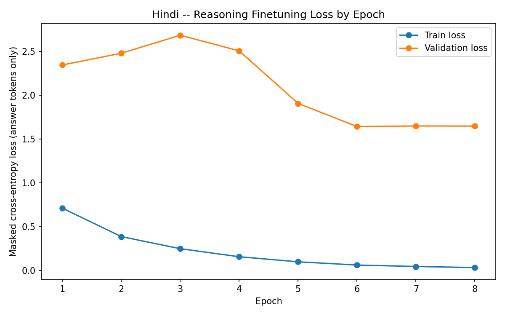
  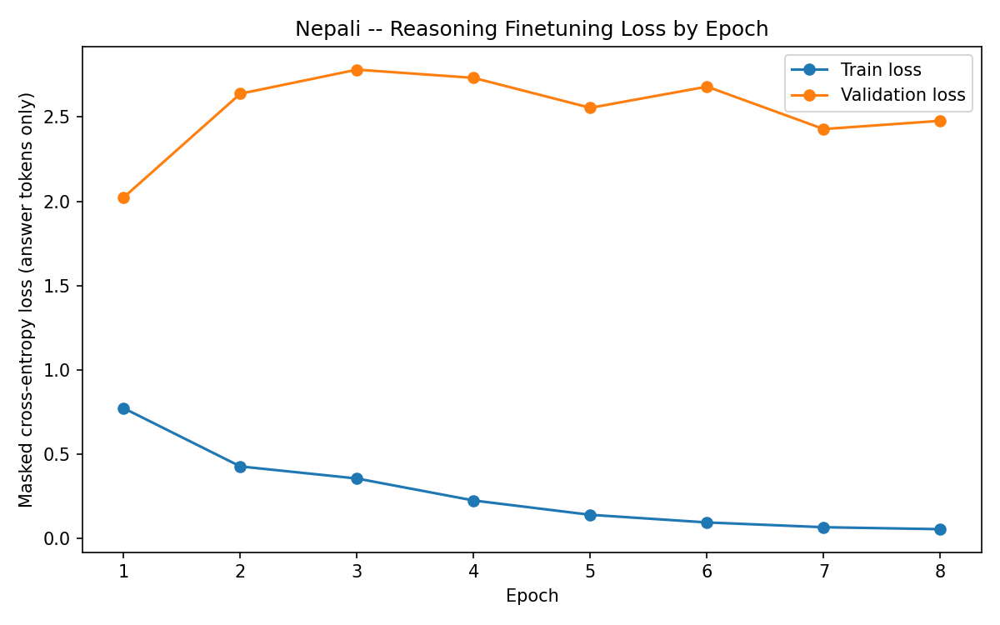
</div>

Here's the epoch-by-epoch numbers behind those plots:

**Hindi:**

| Epoch | Train loss | Validation loss |
|---|---|---|
| 1 | 0.7091 | 2.3454 |
| 2 | 0.3845 | 2.4789 |
| 3 | 0.2466 | 2.6849 |
| 4 | 0.1548 | 2.5060 |
| 5 | 0.0968 | 1.9056 |
| 6 | 0.0599 | **1.6419 (best)** |
| 7 | 0.0433 | 1.6485 |
| 8 | 0.0313 | 1.6471 |

**Nepali:**

| Epoch | Train loss | Validation loss |
|---|---|---|
| 1 | 0.7736 | 2.0233 |
| 2 | 0.4283 | 2.6380 |
| 3 | 0.3566 | 2.7807 |
| 4 | 0.2263 | 2.7318 |
| 5 | 0.1414 | 2.5544 |
| 6 | 0.0963 | 2.6799 |
| 7 | 0.0679 | **2.4284 (best)** |
| 8 | 0.0563 | 2.4773 |

The pattern that jumps out here is the gap between train loss and validation loss.
Train loss falls to almost nothing by the end (0.03 for Hindi, 0.06 for Nepali) —
which makes sense, since the answer is usually just one short entity name out of a
smallish pool, and with 6,000 near-identical-shaped examples the model can fit that
pretty easily. Validation loss, though, never gets anywhere close to that — it stays
around 1.6–2.7 for both languages the whole time, and it isn't a smooth curve
either, it goes up for a few epochs before eventually coming back down. This is
classic overfitting: the model is fitting patterns specific to the training names
and training phrasing rather than the underlying comparison logic, and I can say
that with some confidence precisely *because* validation uses entity names the model
has never seen in training — if it were learning the real skill, val loss should
track train loss reasonably closely, and it doesn't.

I don't think this makes the finetuning a failure, though, and section 3 below is
why: loss and accuracy aren't the same thing. A model can have a high average
cross-entropy loss over the full 9,000-word vocabulary while still, most of the
time, putting the *correct* entity name as its single highest-probability guess.
Loss punishes the model for not being confident about the right answer; accuracy
only cares whether the top guess was right. So the real test of whether finetuning
worked is the accuracy numbers in the next section, not the loss curve by itself.

One practical note: I saved `best.pt` (lowest validation loss so far) and
`latest.pt` (most recent epoch) separately, and every number and plot in this
report after this section uses `best.pt` — for Hindi that's the epoch 6 checkpoint,
for Nepali it's epoch 7. I did not just use whatever the final epoch happened to be.

---

## 3. Did finetuning actually work? Pretrained vs. finetuned accuracy

This is the question that matters most, and it's answered directly by running both
the Phase 2 pretrained checkpoint and the Phase 3 finetuned checkpoint through the
exact same evaluation: greedy-decode an answer for every one of the 800 test
questions, and check whether it's an exact match for the correct entity name.

### 3.1 Overall numbers

| | Model H (Hindi) — pretrained | Model H (Hindi) — finetuned | Model L (Nepali) — pretrained | Model L (Nepali) — finetuned |
|---|---|---|---|---|
| Exact-match accuracy | 0.0% (0/800) | **47.1% (377/800)** | 0.0% (0/800) | **40.1% (321/800)** |

The pretrained number being exactly zero isn't a bug — it's expected. The Phase 2
model was trained purely to predict the next word of ordinary news/Wikipedia text.
It was never once shown a fact-then-question-then-answer structure, so when you feed
it one of these prompts followed by "उत्तर:", it just continues generating text the
way it always does — usually another sentence-like continuation, not a single
correctly-chosen entity name. Getting 0/800 there is exactly what "never trained on
this format" should look like, and it's the right baseline to compare against.

Once finetuned, both models go from 0% to a clear, non-trivial accuracy — 47.1% for
Hindi, 40.1% for Nepali — on questions built entirely from names and (in some cases)
an attribute the model never saw during finetuning. That's the real evidence that
finetuning taught something that generalizes past rote memorization, not just
something that works on the training names specifically. If it had only memorized
training examples, held-out-entity accuracy should look a lot more like the
pretrained baseline (close to 0%), not 40–47%.

### 3.2 Breaking it down by question type

This is where it gets more interesting, and slightly more complicated than "it
worked":

| Question kind | Hindi accuracy | Nepali accuracy |
|---|---|---|
| Pairwise | 20.3% | 13.8% |
| Ranking | 18.6% | 11.3% |
| Transitive | **86.1%** | **82.8%** |

Transitive (the multi-hop chaining questions) comes out far ahead of the other two
— over 80% for both languages, compared to well under 25% for pairwise and ranking.
At first glance this is backwards from what I expected going in, since chaining two
facts together sounds like it should be *harder* than a single direct comparison,
not easier.

Looking more closely at how I built the transitive questions explains a good chunk
of this gap, though, and I want to be upfront about it rather than just reporting
the number without context. In my transitive template, the three people are always
introduced in decreasing order of the attribute (highest first), and the question
always asks about the highest person versus the lowest person, in that order — "A
and C, who is bigger" where A is always the one described first with the higher
value. So the model doesn't strictly need to trace through the middle person B at
all to get the right answer; it likely picked up on a shortcut close to "the
first-named person in the question is very often the right answer" for this
particular question shape, which is a real, useful pattern — the model still has to
correctly pick which held-out entity was named first, it's not simply guessing — but
it isn't quite the same thing as a model proving that it can chain two separate
comparisons together in the general case. That's a limitation of my task design
worth calling out honestly, not a limitation of the model necessarily failing to
learn to compare numbers.

Pairwise and ranking, meanwhile, don't have that same first-mentioned shortcut
available — the correct entity is randomly assigned to either position in a
pairwise question, and randomly assigned to any of the three positions in a ranking
question — so those numbers likely reflect the model's comparison ability more
directly, and they're much more modest: around 14–20%. That's still clearly better
than the pretrained model's 0%, so some real comparison skill did transfer, but it's
a long way from reliable. My read on this is that eight epochs over 6,000 examples,
on a 25-million-parameter model that also has to hold onto everything it learned
about the language during 500M tokens of pretraining, just isn't enough exposure to
fully learn "pick the right one of three names based on unseen numbers" in the
general case — that would need either a lot more finetuning data, more held-out
variety in the templates, or more epochs (at the cost of the overfitting risk from
section 2.2 getting worse).

### 3.3 A few actual examples

Here are some real generations from the finetuned Hindi model, both right and
wrong, straight out of the evaluation run — no cherry-picking, these are just the
first several examples from the results file:

**Correct (transitive):**
> करण की ऊँचाई 188 सेंटीमीटर है। कमल की ऊँचाई 187 सेंटीमीटर है। प्रकाश की ऊँचाई 152
> सेंटीमीटर है। करण और प्रकाश में से कौन बड़ा है?
> Expected: करण — Model said: करण ✓

**Correct (transitive):**
> कमल की वज़न 97 किलोग्राम है। विमल की वज़न 82 किलोग्राम है। प्रकाश की वज़न 32
> किलोग्राम है। कमल और प्रकाश में से कौन बड़ा है?
> Expected: कमल — Model said: कमल ✓

**Wrong (pairwise):**
> राधा की वज़न 118 किलोग्राम है। सीता की वज़न 47 किलोग्राम है। राधा और सीता में से
> किसकी वज़न ज़्यादा है?
> Expected: राधा — Model said: संजय ✗

**Wrong (ranking):**
> सीता की वज़न 114 किलोग्राम है। कमल की वज़न 79 किलोग्राम है। प्रकाश की वज़न 88
> किलोग्राम है। सीता, कमल और प्रकाश में से किसकी वज़न सबसे ज़्यादा है?
> Expected: सीता — Model said: अजय ✗

A pattern I noticed looking through the wrong answers: when the model gets a
pairwise or ranking question wrong, it very often answers with a name that wasn't
even one of the people mentioned in the question at all (अजय, संजय, नेहा, विजय —
none of these appear in the prompts above). That tells me something specific: this
isn't the model picking the *wrong* one of the given options because it got the
comparison backwards — it's more that it sometimes fails to even restrict its
answer to the set of names actually present in the question. That's a different
kind of failure than "bad at comparing numbers", and it's a plausible symptom of the
same overfitting the loss curves showed — on unfamiliar (held-out) names, the model
sometimes falls back to whichever names appeared most often in training, rather
than reliably reading the specific names out of this particular prompt.

The Nepali model shows the same overall shape (correct examples almost all in the
transitive category, wrong examples on pairwise/ranking sometimes naming someone not
present in the prompt) — I won't repeat every example here since they follow the
identical pattern, just in Nepali.

Full result files with every checkpoint's accuracy, per-kind breakdown, and a set of
sample generations are at `report/phase3/hindi/reasoning_metrics.json` and
`report/phase3/nepali/reasoning_metrics.json`.

---

## 4. Attention analysis: did finetuning change how the model looks at its input?

The assignment asks me to reuse the same attention toolkit from Phase 2 — the code
that pulls out every layer's attention weights, computes entropy and mean attention
distance per head, and draws heatmaps — but this time point it at the finetuned
checkpoints instead of the pretrained ones, and specifically look at what happens
on comparative-reasoning prompts (rather than the news-text examples I used in
Phase 2).

I didn't need to change any of that underlying code at all — the attention-capture
function only needs a model and a sequence of tokens, so running it against a
finetuned checkpoint required nothing more than pointing it at a different file.
That's a nice confirmation that keeping the attention analysis code decoupled from
which specific checkpoint it's looking at, back in Phase 2, was the right call.

### 4.1 Entropy by layer, pretrained vs. finetuned

Entropy here measures how spread out each attention head's attention is across the
sequence — low entropy means a head is focusing sharply on just a few tokens, high
entropy means it's spreading its attention thin across many tokens.

<div align="center">
  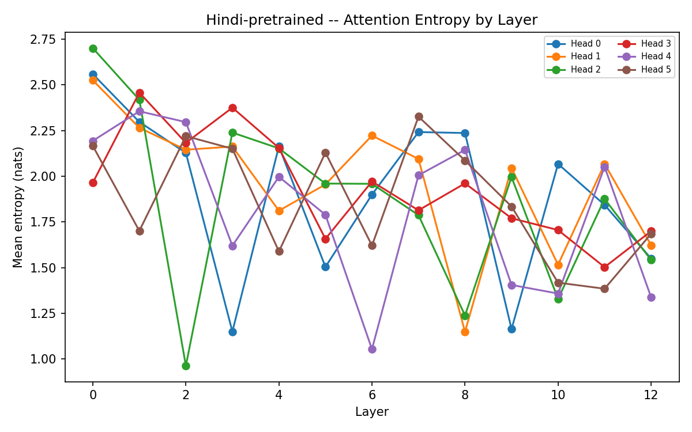
  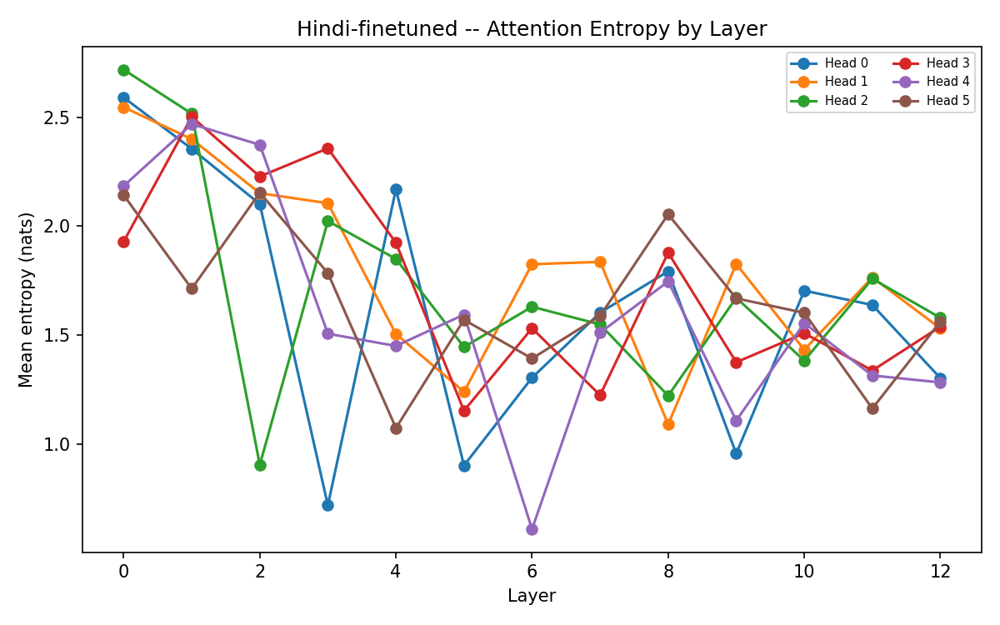
</div>

<div align="center">
  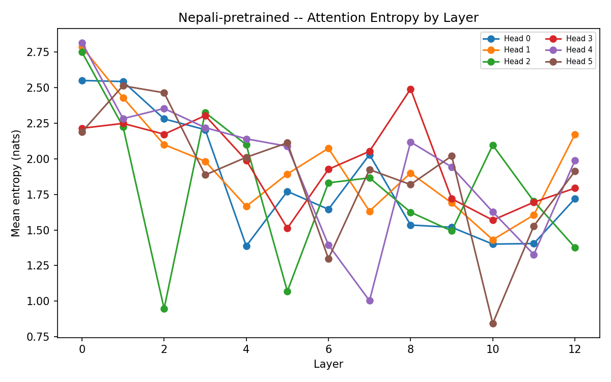
  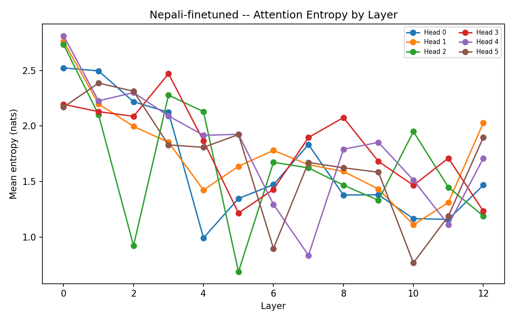
</div>

Averaging entropy across all six heads at each layer, here's what happens to Hindi
going from pretrained to finetuned:

| Layer | Pretrained avg. entropy | Finetuned avg. entropy | Change |
|---|---|---|---|
| 0 | 2.352 | 2.351 | ~0 |
| 1 | 2.250 | 2.325 | +0.076 |
| 2 | 1.990 | 1.985 | ~0 |
| 3 | 1.950 | 1.749 | −0.201 |
| 4 | 1.979 | 1.662 | −0.317 |
| 5 | 1.833 | **1.317** | **−0.516** |
| 6 | 1.788 | 1.382 | −0.406 |
| 7 | 2.045 | 1.552 | −0.493 |
| 8 | 1.803 | 1.631 | −0.172 |
| 9 | 1.703 | 1.434 | −0.269 |
| 10 | 1.566 | 1.531 | −0.035 |
| 11 | 1.788 | 1.496 | −0.292 |
| 12 | 1.573 | 1.466 | −0.107 |

Nepali follows the exact same shape:

| Layer | Pretrained avg. entropy | Finetuned avg. entropy | Change |
|---|---|---|---|
| 0 | 2.551 | 2.533 | −0.019 |
| 1 | 2.374 | 2.257 | −0.117 |
| 2 | 2.053 | 1.973 | −0.080 |
| 3 | 2.154 | 2.108 | −0.046 |
| 4 | 1.882 | 1.690 | −0.193 |
| 5 | 1.741 | **1.457** | **−0.285** |
| 6 | 1.695 | 1.425 | −0.271 |
| 7 | 1.752 | 1.586 | −0.166 |
| 8 | 1.915 | 1.655 | −0.260 |
| 9 | 1.731 | 1.544 | −0.187 |
| 10 | 1.495 | 1.329 | −0.166 |
| 11 | 1.544 | 1.322 | −0.222 |
| 12 | 1.827 | 1.589 | −0.238 |

Two things stand out, and they're consistent across both languages, which makes me
more confident this isn't noise:

First, layer 0 and layer 2 barely move at all. That makes sense to me — the very
first layer of a Transformer is mostly still doing generic, low-level work (picking
up local word patterns, basic syntax), and that kind of processing doesn't need to
change much just because the downstream task changed. Finetuning shouldn't need to
touch what the earliest layer is doing.

Second, the biggest drops both happen in the middle of the stack — layer 5 for
Hindi, layer 5 for Nepali too, as it happens — and layers 4 through 9 generally show
the largest changes for both languages. This is where I'd expect the actual
"figure out which number is bigger and pick the matching name" computation to
happen, if the model is doing anything resembling real reasoning: not in the very
first layer (too early, hasn't even finished processing the raw tokens) and not
usually right at the very last layer either (that's closer to committing to an
output). A drop in entropy there means attention got sharper and more selective in
exactly the part of the network where I'd expect the reasoning to be happening —
which fits with what section 3 found through a completely different measurement
(accuracy).

### 4.2 Mean attention distance by layer

Mean attention distance measures, on average, how far back in the sequence each
head's attention reaches — a small number means a head mostly looks at nearby
tokens, a large number means it reaches far back into the context.

<div align="center">
  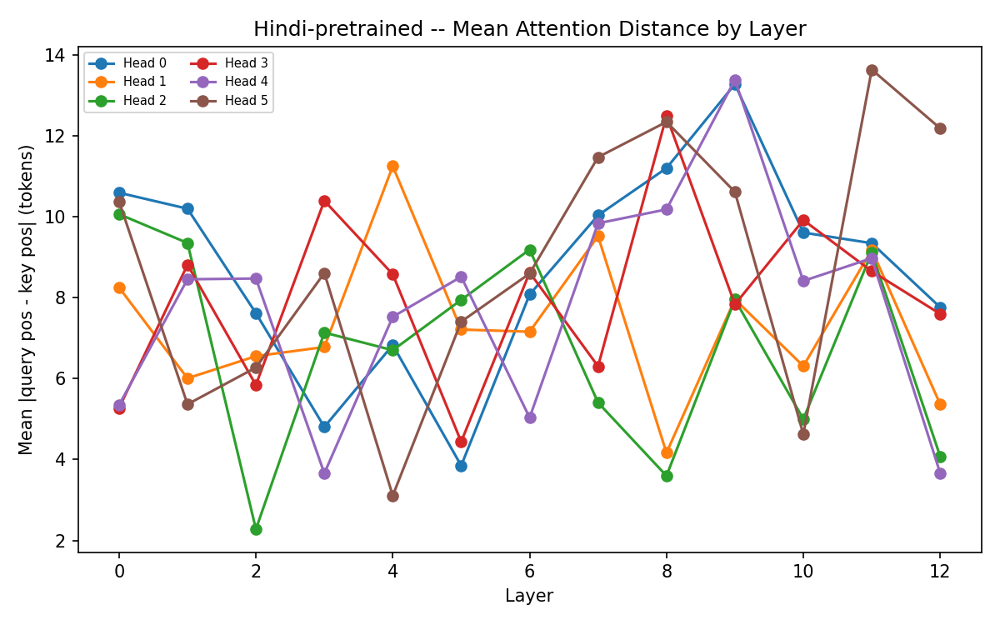
  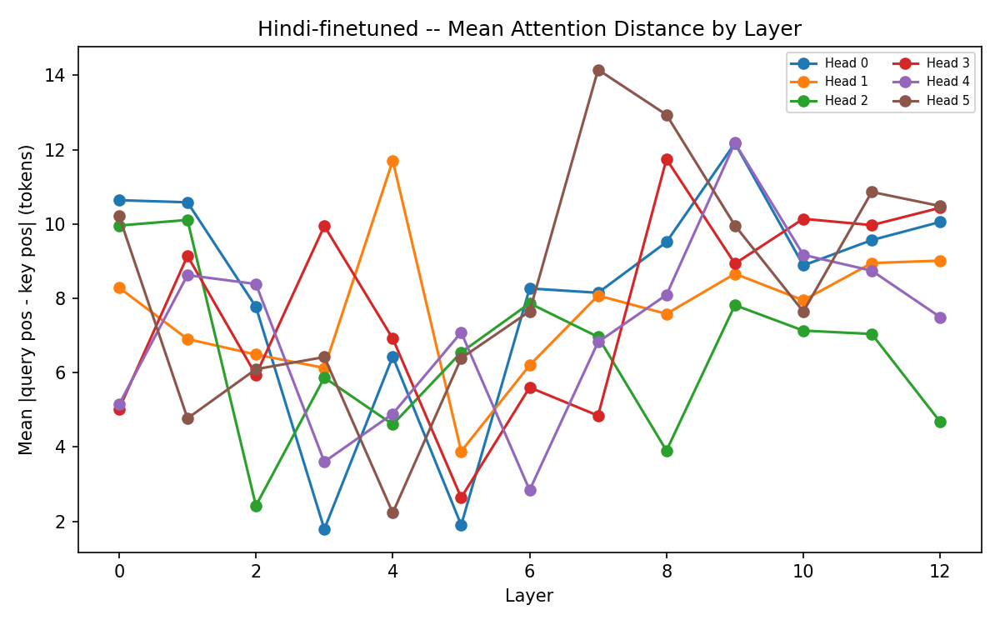
</div>

<div align="center">
  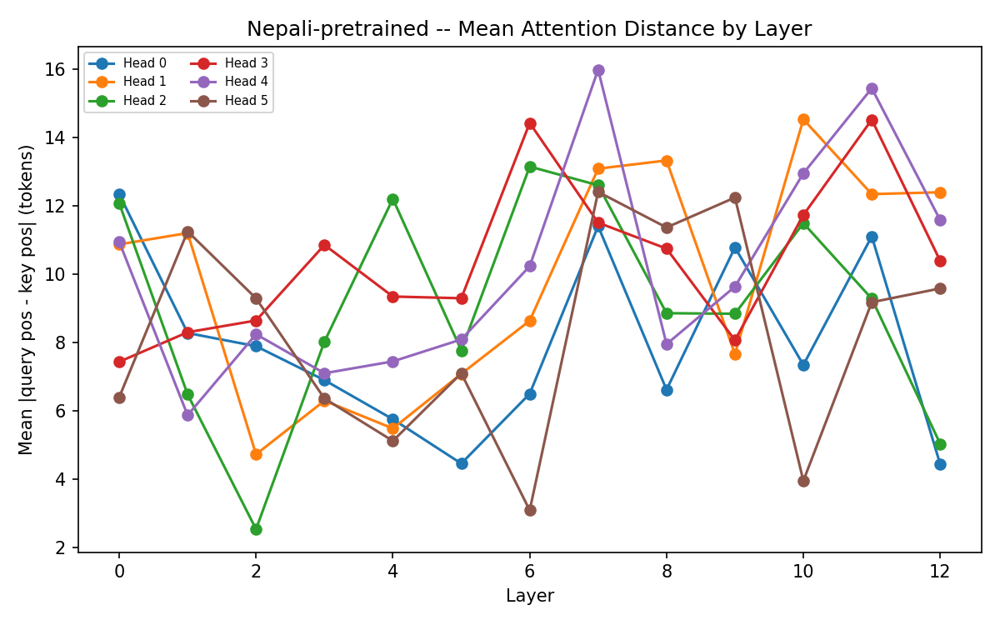
  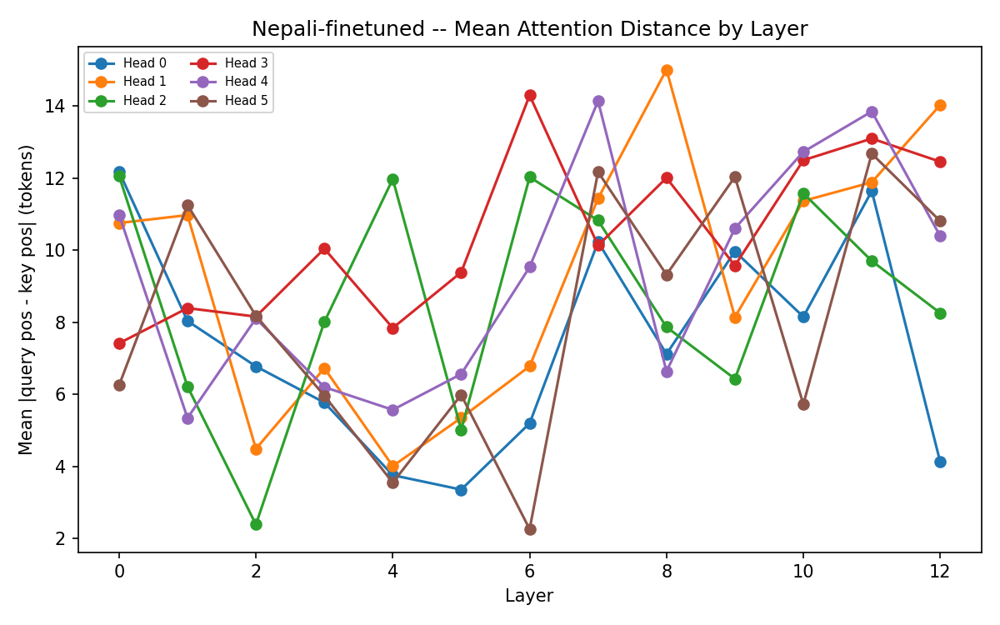
</div>

For Hindi, the same middle layers that showed the biggest entropy drop also show
the biggest drop in attention distance — layer 5 goes from an average distance of
about 6.6 tokens (pretrained) down to about 4.7 tokens (finetuned), and layers 3, 4,
and 6 all drop by roughly one to two tokens as well. That's the same story told
twice: in those layers, attention isn't just getting sharper, it's specifically
pulling in *closer* — which lines up with what a comparison question actually needs,
since the number and the name it belongs to sit right next to each other in the
sentence ("सीता की वज़न 114 किलोग्राम है" — the relevant number is only a few tokens
away from the relevant name). Interestingly, a couple of the later layers (10 and
12) actually show attention reaching slightly *further* after finetuning, not less
— my guess is that those later layers are where the model needs to look back across
the whole set of facts it just read to decide on a final answer, so some amount of
long-range attention there is exactly what you'd want, not a sign of anything going
wrong.

### 4.3 What the heatmaps look like

Model H (Hindi) has 13 layers, indexed 0 through 12. "Early layer" below means
layer 0 (the first block the tokens pass through); "late layer" means layer 12
(the last block before the final normalization and output head).

**Layer 0, pretrained vs. finetuned:**

<div align="center">
  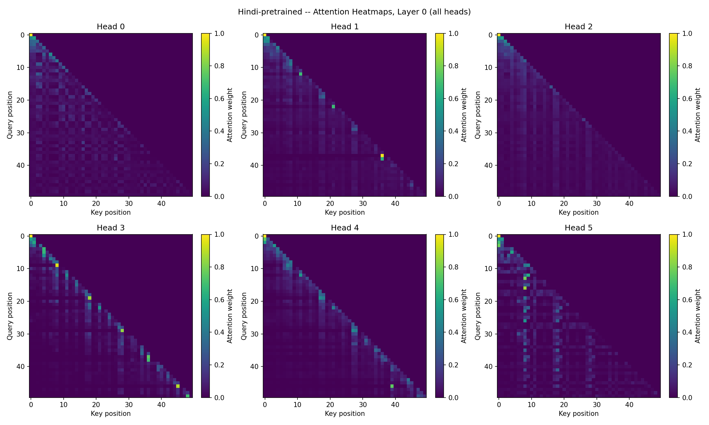
  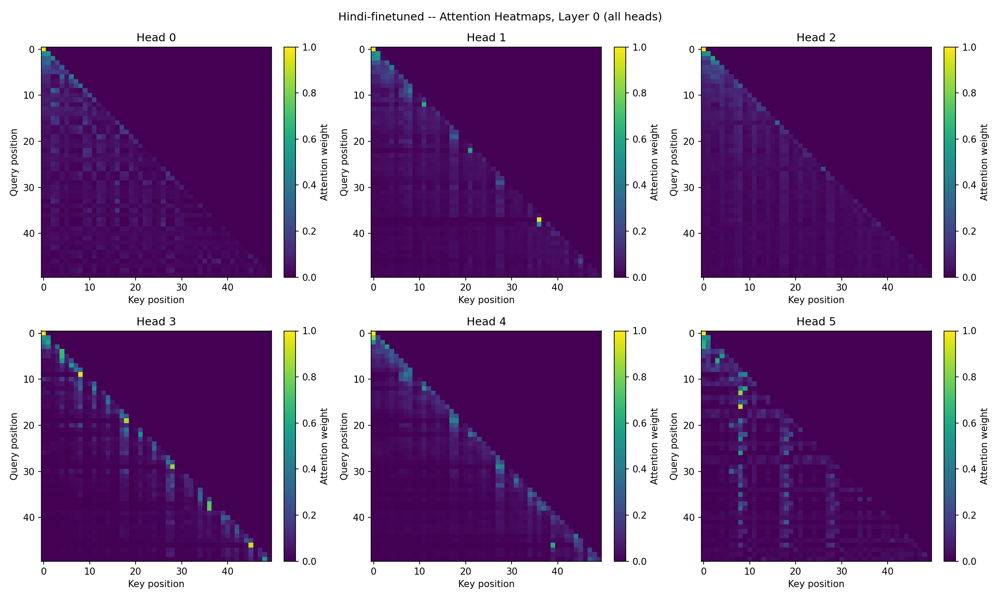
</div>

Pretrained is on the left, finetuned is on the right, same question, same layer.
These two look almost the same to me — most heads in both versions show a clear
diagonal band, each position mostly attending to itself and the few tokens right
before it, which is a completely standard "local/positional" pattern for the
earliest layer in the network. This matches the entropy table in section 4.1:
layer 0's entropy barely moved after finetuning (2.352 to 2.351), and looking at
the two images side by side backs that number up directly — layer 0 isn't doing
anything task-specific, finetuned or not, it's still doing the same generic
early-layer processing either way.

**Layer 12 (the last layer), pretrained vs. finetuned:**

<div align="center">
  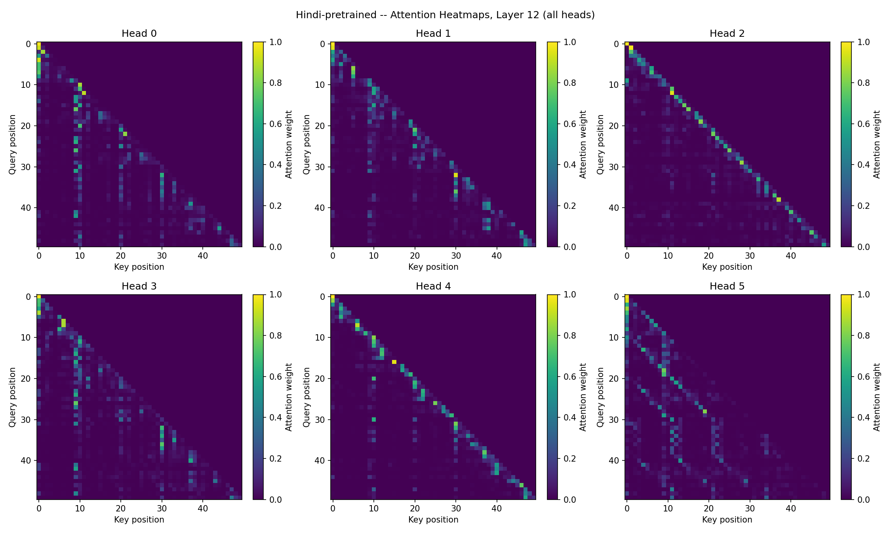
  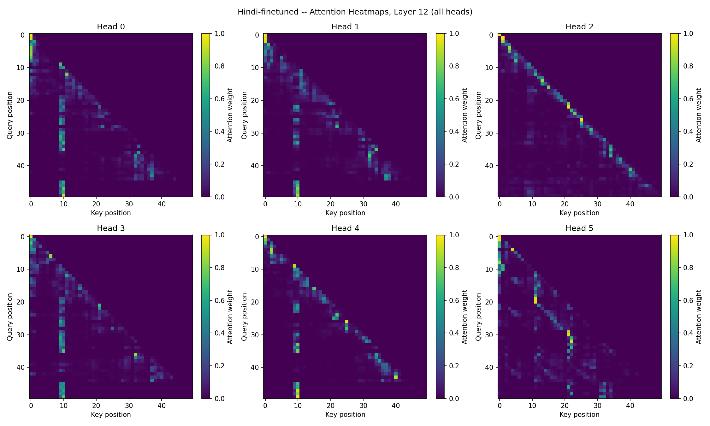
</div>

Here the two versions genuinely look different, and it's a difference I can point
to directly rather than just claim. In the pretrained version (left), most heads
have their attention mass spread across several separate bright points scattered
along the key axis — Head 1, for instance, has distinct bright spots near
positions 5, 30, and 38, not concentrated on any one of them. In the finetuned
version (right), several heads (0, 3, and 4 especially) have collapsed down to one
dominant, consistent vertical stripe at a single key position — around token 10 in
this example — that almost every query position after it keeps attending back to,
instead of splitting attention across several separate points the way the
pretrained version did. Token position 10 in this particular example lands right
around where the first person's numeric value appears in the sentence, so a
believable read on this is that finetuning taught these heads to lock onto "the
number I need to compare against" as one fixed reference point, rather than
spreading attention across everything that seemed locally interesting the way the
pretrained model did on ordinary text. Head 2 is the exception — it keeps a
mostly diagonal, local pattern in both the pretrained and finetuned versions — so
this concentration effect isn't something that happened to every head uniformly;
some heads specialized into this fixed-reference-point role and others stayed
local throughout, both before and after finetuning.

The Nepali heatmaps (`report/phase3/nepali/plots/`) show the same general pattern
— layer 0 barely changes between pretrained and finetuned, layer 12 goes from
several scattered attention points to one or two heads concentrating sharply on a
single position — I won't reproduce every image here since the story is the same,
just on Nepali sentences, but the files are there to check directly.

### 4.4 What I take away from this

Putting the loss curves, the accuracy numbers, and the attention analysis together,
my honest read is: finetuning genuinely changed the model's behavior in a way that's
visible from three independent angles — it produces the right answer far more often
than the untouched pretrained model (section 3), and specifically in the middle
layers of the network, attention got both sharper (lower entropy) and more
localized around the relevant fact (shorter mean distance), which is exactly the
kind of change you'd want to see if a model were learning to extract a specific
number from a sentence and hold onto it (section 4). At the same time, the
accuracy numbers show this new skill isn't fully reliable yet outside of the
transitive question type, which the attention data doesn't fully explain by itself
— that limitation seems to come more from the small size of the finetuning dataset
and the task design (section 3.2) than from attention not adapting at all.

---

## 5. Bringing it all together: Hindi vs. Nepali across all three phases

This section is what the assignment calls the final consolidated comparison —
pulling in the headline numbers from Phase 1 and Phase 2 alongside what I found in
this phase, and trying to answer the four questions the assignment asks directly.

### 5.1 How did data scale and quality differ between Model H and Model L?

| | Model H (Hindi) | Model L (Nepali) |
|---|---|---|
| Final training tokens (Phase 1) | ~679M | ~568M |
| Manual-collection share | ≥25% (measured) | ≥25% (measured) |
| Tokenizer vocabulary | 9,000 | 9,000 |
| Avg. characters per token | 3.86 | 4.22 |

Hindi ended up with roughly 20% more raw training text than Nepali by the time
collection finished, mostly because Hindi has a much bigger pool of crawlable news
sites with proper sitemaps and a much larger Wikipedia to draw from — this was
already visible back in Phase 1's source list, where I had five working manual
domains for each language, but Hindi's individual domains (jagran.com, patrika.com,
etc.) simply publish more articles per day than the Nepali equivalents I could
find. Tokenizer fertility also comes out worse for Nepali — 4.22 characters per
token versus Hindi's 3.86 — which means the same amount of raw text turns into
*more* tokens for Nepali, i.e. Nepali content is somewhat more expensive to
represent in the shared token budget, on top of there being less of it to start
with. Both are legitimate lower-resource symptoms of the same underlying fact:
there is simply more Hindi text on the public internet than Nepali text, for a
model of this scale to learn from.

Both models did clear the assignment's 20% manual-collection floor with margin (I
deliberately targeted 25% during collection to leave headroom for cleaning losses,
described in the Phase 1 report), so neither model relied overwhelmingly on
downloaded public corpora — a meaningful chunk of what both models saw was text I
crawled and cleaned myself.

### 5.2 How do language-modeling and reasoning results compare across the two tiers?

| Metric | Model H (Hindi) | Model L (Nepali) |
|---|---|---|
| Pretraining validation perplexity | 15.77 | 23.78 |
| Pretraining validation BPB | 0.4063 | 0.4089 |
| Reasoning accuracy, pretrained | 0.0% | 0.0% |
| Reasoning accuracy, finetuned | 47.1% | 40.1% |
| — pairwise | 20.3% | 13.8% |
| — ranking | 18.6% | 11.3% |
| — transitive | 86.1% | 82.8% |

Hindi comes out ahead of Nepali on every single one of these numbers, and the gap
is fairly consistent in size — Hindi's perplexity is meaningfully lower (15.77 vs.
23.78, meaning Hindi's model is, on average, noticeably less "surprised" by real
held-out Hindi text than Nepali's model is by real held-out Nepali text), and Hindi
also comes out about 7 percentage points ahead on overall reasoning accuracy after
finetuning (47.1% vs. 40.1%). Interestingly, the BPB gap between the two languages
is much smaller than the perplexity gap (0.4063 vs. 0.4089 — almost the same) —
which is exactly why the assignment asks for BPB alongside perplexity: perplexity
is measured per *token*, and the two languages have different tokenizers with
different fertility, so a chunk of Hindi's perplexity advantage is really just an
artifact of Hindi tokenizing into shorter, more "predictable" pieces per token,
not necessarily the model itself being that much better per unit of actual text.
BPB, which is normalized by raw bytes of text rather than by token count, shows the
underlying gap between the two languages is much smaller than perplexity alone
would suggest.

The reasoning-accuracy gap held up in the same direction as the language-modeling
gap, though — Hindi ahead on both — which at least means the two kinds of
evaluation agree with each other about which model is stronger overall, even if the
exact size of the gap differs between metrics.

### 5.3 What tokenizer/corpus factors most affected the lower-resource model?

Two things, most directly. First, Nepali's higher tokenizer fertility (4.22 vs.
3.86 characters/token) means that for the same context window of 256 tokens, the
Nepali model effectively "sees" less raw text per training example than the Hindi
model does — the same sentence simply takes more tokens to represent in Nepali,
so more of that fixed window gets used up per sentence, leaving less room for
additional context. Second, the raw token-count shortfall (568M vs. 679M) means
the Nepali model, at a fixed number of pretraining steps, made fewer effective
passes over genuinely distinct text — some of what it trained on was necessarily
repeated more than Hindi's larger pool needed to be repeated, at the batch sizes
and step counts both models actually used.

I don't think either of these fully explains the size of the reasoning-accuracy gap
by itself, though, since the reasoning task itself was built completely separately
from the pretraining corpus (same-sized finetuning set, same hyperparameters, same
number of epochs, for both languages) — a weaker starting checkpoint from Phase 2
Pretraining likely just gave the Nepali finetuning run a slightly worse foundation
to build on, and that disadvantage carried through into a somewhat lower reasoning
accuracy after finetuning, without me needing to assume anything went wrong
specifically in Phase 3 itself.

### 5.4 What evidence explains the observed differences?

Putting every piece of evidence from all three phases together, the story that
comes out consistently is: Hindi had a real, measurable resource advantage at every
single stage of this project, and it shows up as a modest, consistent advantage in
the final model at every stage too, never a single large gap that swamps everything
else. Hindi had about 20% more pretraining tokens and a lower-fertility tokenizer,
which is reflected in a lower BPB and a meaningfully lower perplexity at the end of
Phase 2. Going into Phase 3, that translated into a somewhat better foundation for
the reasoning finetuning to build on top of, and Hindi came out around seven
percentage points ahead in the end. None of these effects is dramatic by itself
(nothing here is a 10x or even 2x difference), and I think that matches the reality
of the two languages: Nepali is genuinely lower-resource than Hindi, but not by an
enormous margin for the specific set of sources I was able to work with (both
Devanagari, both with real news sites and a real Wikipedia to draw from) — a more
extreme lower-resource language from the assignment's allowed list, with far less
public web text overall, would likely have shown a much bigger gap than what I
found here.

---

## 6. Reproducing this phase

From the repo root, with the Phase 2 checkpoints and tokenizers already in place:

```bash
# 1. Generate the reasoning dataset (writes to <lang>/reasoning/splits/)
python -m hindi.reasoning.generate
python -m nepali.reasoning.generate

# 2. Finetune from the Phase 2 checkpoint (writes to <lang>/reasoning/checkpoints/)
python -m hindi.reasoning.finetune
python -m nepali.reasoning.finetune

# 3. Evaluate pretrained vs. finetuned accuracy on the test set
python -m hindi.reasoning.eval
python -m nepali.reasoning.eval

# 4. Compare attention before and after finetuning
python -m hindi.reasoning.attention_compare
python -m nepali.reasoning.attention_compare
```

Every script defaults to the repo-relative paths this project already uses, so
running them with no arguments reproduces exactly what's in this report. All of the
numbers and plots in this report come straight out of these scripts — none of it is
hand-typed or estimated.

## Google Drive links

Model checkpoints from this phase (finetuned, resumable format — weights, optimizer
state, scheduler state, epoch, and config, same as Phase 2):

- **Model H (Hindi) finetuned checkpoint:** https://drive.google.com/drive/folders/1K92Wc8C7KOV8bcjj1cUYb49aTHLZClaJ?usp=sharing
- **Model L (Nepali) finetuned checkpoint:** https://drive.google.com/drive/folders/1diZrfo1JVBqhmnwv__Zd9iA2bzuG4Zgn?usp=sharing

Both are set to "anyone with the link can view."
